# 数字图像处理课程实验报告

## 实验项目封面

**课程名称：** 数字图像处理

**实验项目：**

- **Project 04-03：** Gaussian Lowpass Filtering（高斯低通滤波）
- **Project 04-04：** Highpass Filtering Using a Lowpass Image（使用低通图像的高通滤波）
- **Project 04-05：** Correlation in the Frequency Domain（频率域相关）

**小组成员：**

- 李可，24325140
- 唐咏妍，24325241
- 刘思含，24325185

**截止日期：** 待填写　　**提交日期：** 待填写

## 小组成员分工及贡献

- **李可：** 主要负责公共图像处理基础框架及 Project 04-03 的代码实现、结果整理和实验分析；参与 04-04、04-05 的程序复现、公共接口测试、图像处理流程核对，并协助检查实验参数和结果是否符合题目要求。
- **唐咏妍：** 主要负责 Project 04-04 的算法实现、参数或条件对比实验及结果分析；同时参与 04-03 和 04-05 的运行验证、结果对照和问题反馈，协助完善实验现象说明、参数记录及报告中的技术分析。
- **刘思含：** 主要负责 Project 04-05 的算法分析、程序实现、结果验证和实验分析；参与 04-03、04-04 的复现与交叉检查，收集和核对各项目的代码、结果图及说明材料，完成三项实验的统一整合、报告排版、贡献说明和最终检查。
- **共同协作：** 三位成员分别完成主要负责项目后，互相复现运行结果，核对输入、参数、输出图像和实验结论，并共同完善实验报告的格式、图表引用、结果分析与提交材料，确保报告内容与实际程序实现相互对应。

## Project 04-03 高斯低通滤波

### 项目摘要

**摘要：** 本实验实现二维高斯低通滤波器，并用频域乘法对字符测试图进行平滑。程序支持指定滤波器尺寸 M×N 和中心位置，实际图像滤波将中心放在移位后的直流频率处。输入为 688×688 的 8 位灰度 TIF，按参考图图注采用 D₀=5、15、30、80、230，主实验使用题目允许的不填充近似。D₀=15 对应 Fig. 4.18(c)，结果保留大字符和较大的方块轮廓，同时弱化细线、小字符及随机纹理；其归一化均值为 0.812999，与原图一致，梯度能量保留比例为 0.408%。随着 D₀ 增大，图像逐渐清晰，平滑程度降低。七项数值测试通过，验证了滤波响应、频率衰减及接口的正确性。

### 技术讨论

#### 实验题目、内容与目的

题目要求分为两部分。首先实现 Eq. (4.3-7) 中的二维高斯低通函数，允许指定输出尺寸和中心位置；其次对与 Fig. 4.11(a)、Fig. 4.18(a) 对应的字符测试图进行低通滤波，得到 Fig. 4.18(c) 所示的平滑效果。通过不同参数对比，理解低频轮廓、高频细节与平滑程度之间的关系。

#### 算法原理与实现技术

二维离散傅里叶变换为

$$
F(u,v)=\sum_{x=0}^{M-1}\sum_{y=0}^{N-1}f(x,y)e^{-j2\pi(ux/M+vy/N)}
$$

采用 `fftshift` 将直流项移到频谱中央。高斯低通响应为

$$
H(u,v)=\exp[-D^2(u,v)/(2D_0^2)],\quad D^2(u,v)=(u-u_c)^2+(v-v_c)^2.
$$

其中 M、N 是数组的行数和列数；(u_c,v_c) 是指定中心，程序按零起始的 (row,column) 顺序接受坐标；D₀>0 是频率网格中的高斯尺度，单位为 DFT 频率格点，不是空间像素。中心响应为 1，当 D=D₀ 时响应为 exp(-1/2)≈0.606531；因此 D₀ 并非理想低通滤波器的硬截止边界。

频域滤波及反变换为

$$
G=F_c H,\qquad g=\mathrm{Re}(\mathrm{IFFT2}(\mathrm{ifftshift}(G)))
$$

F_c 表示中心化频谱。真实滤波使用中心 (⌊M/2⌋,⌊N/2⌋)，本次为 (344,344)，保证与 `fftshift` 的直流位置一致；奇数尺寸也使用同一约定。对于偶数尺寸，频谱中心化也可通过输入乘 (-1)^(x+y) 完成，此处用频谱置换实现，适用于任意正整数尺寸。

主实验不填充，采用周期边界。零填充选项会将图像扩展为 2M×2N 并裁剪左上 M×N，改变边界条件及频率格点的尺度。若希望维持相同的归一化频率带宽，填充为两倍尺寸时应将 D₀ 同时扩大两倍；不同边界下仍可能产生不同结果。

所有处理使用 float64 和 complex128。输入按 255 转为 [0,1]，不做逐图对比度拉伸。输出保留浮点 `.npy` 供后续高通减法使用；PNG 仅在保存时截断到 [0,1] 并量化为 8 位。频谱采用 log(1+|F|) 显示，所有输入与输出频谱共享 [0,12.860555] 的对数幅值范围，保证视觉比较有一致尺度。滤波器以 [0,1] 显示。

#### 程序设计与实现

1. `common_io.read_gray` 读取图像；RGB 经灰度转换，8/16 位无符号灰度按各自位深归一化。
2. `gaussian_lowpass(shape,d0,center)` 由距离函数直接构造响应，并检查尺寸、尺度和中心坐标。
3. `apply_frequency_filter` 执行 FFT、频谱中心化、逐点相乘及逆移位反变换，保留复数逆变换结果。
4. `filter_image` 构造以直流为中心的低通响应，检查虚部残差，再提取实部。
5. 入口程序完成五组参数实验，保存原图、频谱、响应、输出、对比图及浮点数组。
6. CSV 和 JSON 记录参数、图像哈希、环境版本及数值指标，保证结果可复现。

任意中心位置用于满足滤波器函数构造要求。额外生成 180×240、中心 (60,160)、D₀=15 的响应（图 04-03-6），证明尺寸和中心参数确实可配置。偏离直流的响应可能破坏共轭对称性，不能假定其逆变换为实数；公共底层函数保留复数，主实验使用标准中心。

#### 关键代码展示

```python
row, col = np.ogrid[:shape[0], :shape[1]]
H = np.exp(-0.5 * (((row - center[0]) / d0) ** 2
                   + ((col - center[1]) / d0) ** 2))
F = np.fft.fftshift(np.fft.fft2(image))
G = F * H
inverse = np.fft.ifft2(np.fft.ifftshift(G))
output = inverse.real
```

以上对应 `gaussian_lowpass` 和 `apply_frequency_filter` 中的核心计算。完整程序及异常检查见附录，FFT 计算调用 NumPy 标准函数。

#### 实验环境

- 操作系统：Windows 11
- 编程语言：Python 3.12.14。
- 依赖库：NumPy 2.3.5、Pillow 12.3.0。
- 输入：688×688、8 位灰度 TIF；处理范围为 [0,1]。
- FFT 尺寸：688×688；中心 (344,344)；主实验不填充。
- 参数：D₀=5、15、30、80、230；目标图 (c) 使用 D₀=15。
- 输出：8 位 PNG、float64 NPY、CSV 指标表和 JSON 元数据。

### 结果讨论

图 04-03-5(a) 为原图，(b) 至 (f) 分别为五组滤波结果，布局对应参考图。D₀=5 时图像显著模糊，大字符只保留粗略轮廓，线条相互融合，右侧随机纹理大部分消失。D₀=15 时大字符和大方块可辨识，较细线条及小字符仍明显模糊，随机纹理显著减弱，与参考图 (c) 的主要视觉特征相符。

D₀=30 时线条和小字符的区分度提高；D₀=80 时大部分主体结构已接近原图；D₀=230 时边缘及纹理进一步恢复，但最高频成分仍受到衰减。D₀ 较小对应更窄的频域响应（图 04-03-3），输出频谱的高频区更暗（图 04-03-4），与空间域平滑增强一致。

下表由保存前的浮点输出计算。RMSE 为相对原图的均方根差，仅衡量滤波造成的变化。

| D₀ | 均值     | 标准差   | 相对原图 RMSE | 梯度能量保留比例 % |
| --- | -------- | -------- | ------------- | ------------------ |
| 5   | 0.812999 | 0.115621 | 0.230930      | 0.032              |
| 15  | 0.812999 | 0.178088 | 0.178927      | 0.408              |
| 30  | 0.812999 | 0.211232 | 0.144403      | 1.500              |
| 80  | 0.812999 | 0.241806 | 0.106900      | 6.384              |
| 230 | 0.812999 | 0.262083 | 0.048175      | 36.853             |

梯度能量定义为周期边界下水平及垂直一阶差分平方和的全图均值，保留比例为输出与原图的比值。原图均值 0.812999、标准差 0.277305。五组均值均保持不变，是因为 H 在直流位置为 1；D₀ 越大，标准差及梯度保留比例越高，相对原图 RMSE 越低。这些数值与图像由模糊向清晰变化的趋势一致。D₀=15 的梯度保留比例为 0.408%，反映细小结构受到明显抑制，不代表仅保留了相同比例的总图像信息。

五组反变换的最大虚部残差均小于 4.2×10⁻¹⁶，属于浮点计算误差。七项自动测试覆盖任意尺寸及中心、偶数与奇数尺寸的直流和均值保持、已知二维正弦波的理论衰减、与直接周期卷积的一致性、非中心响应的复数结果、灰度保存及 RGB 读取、非法参数和填充尺寸。

与参考印刷图的对比采用视觉核对。实验结果显示的是实际 TIF 的处理输出；未对输出添加印刷网纹或额外对比度调整。

### 结果图

图 04-03-1 原始字符测试图。输入 TIF 转为 PNG，固定 [0,1] 灰度显示，未缩放处理数组。

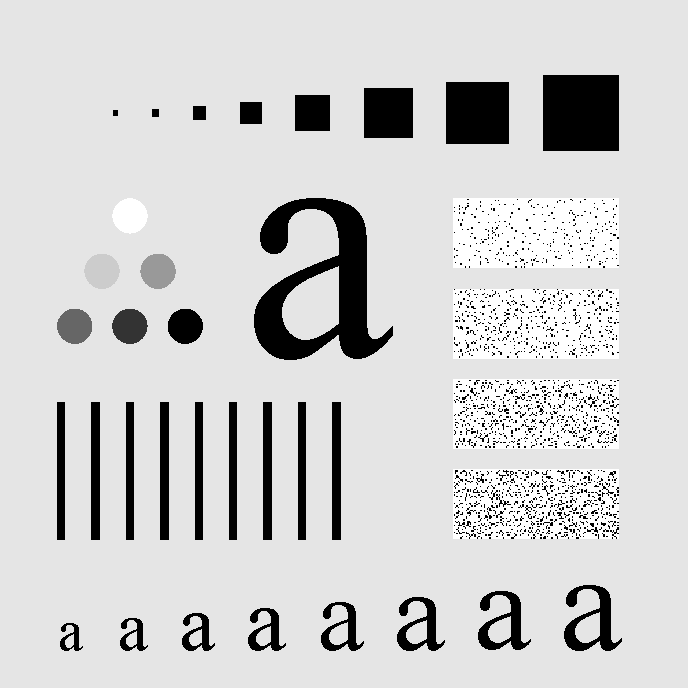

图 04-03-2 输入中心化频谱。显示 log(1+|F|)，对数幅值范围 [0,12.860555]，中心为 (344,344)。

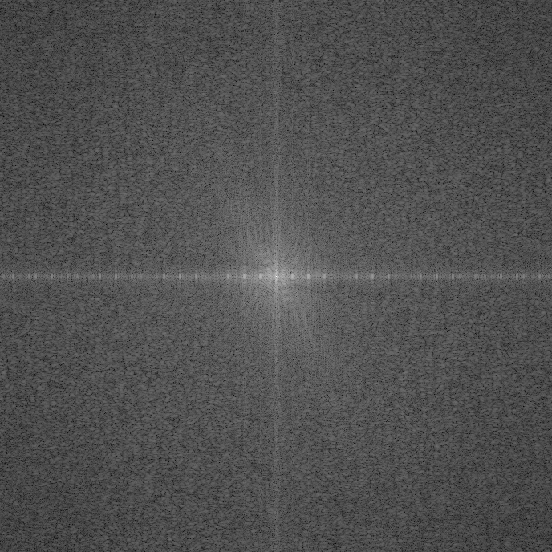

图 04-03-3(a) 至 (e) 高斯低通响应，D₀ 依次为 5、15、30、80、230；原始响应尺寸均为 688×688，固定 [0,1] 显示。面板仅为排版缩小，单独 PNG 保留原始尺寸。

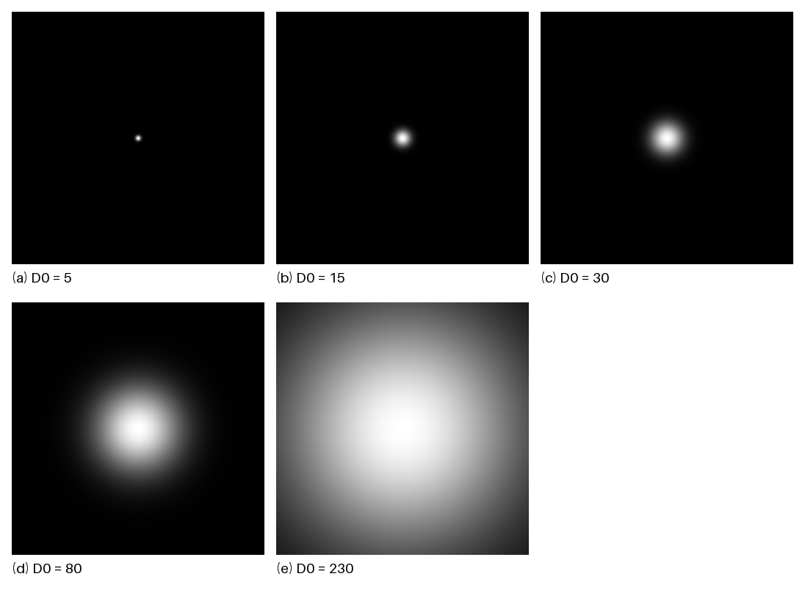

图 04-03-4(a) 至 (e) 滤波后中心化频谱，参数与图 04-03-3 一致；全部与输入频谱共用对数幅值显示范围，不单独拉伸。

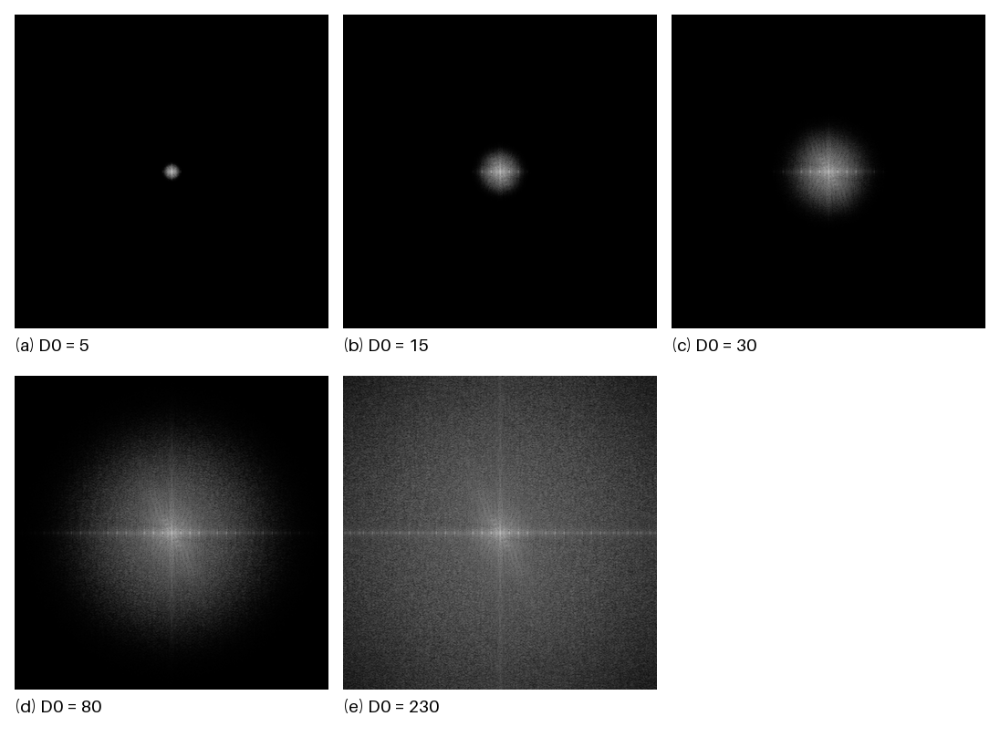

图 04-03-5(a) 原图；(b) 至 (f) 分别为 D₀=5、15、30、80、230 的输出。(c) 为目标结果，固定 [0,1] 灰度显示，无填充；所有单独输出为 688×688。

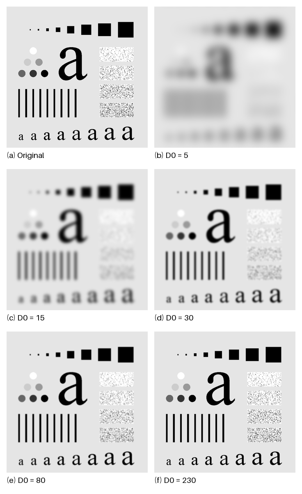

图 04-03-6 指定尺寸与中心的滤波器示例。响应尺寸 180×240，中心 (60,160)，D₀=15；只验证函数构造，不参与目标图滤波。

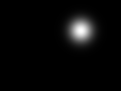

### 创新点及思考

本实验将题目规定的滤波实现与补充验证区分开。可配置尺寸、中心及高斯响应属于必做内容；七项数值测试、统一频谱显示范围和保存浮点交接结果属于复现与工程质量的补充工作。

高斯响应连续衰减，较硬截止响应更易避免明显振铃，但平滑仍会损失有用的边缘和细纹理。选择 D₀ 应考虑目标结构尺度；参数较小适合更强的平滑，参数较大有利于保留细节。本次 D₀=15 依据参考图确定，不表示对所有图像最优。频域高斯与空间域高斯有傅里叶对应关系，正方形 M=N 情况下空间尺度约为 σ=M/(2πD₀)；本次 D₀=15 对应约 7.30 像素。离散采样、有限尺寸及边界策略会影响两种实现的细微差异。

### 实验总结

实验实现了从图像读取、预处理到高斯响应构造、频域相乘和输出保存的完整流程。通过 D₀=15 的目标结果及五组对比，可以观察高频抑制引起的细节损失与轮廓保留。中心位置必须与 FFT 移位约定一致；保存结果时应区分物理灰度和诊断显示；交接给后续项目的低通结果应保留浮点值，以避免 8 位量化和对比度拉伸影响减法。

### 完整程序清单

#### src/common_io.py

```python
"""Shared grayscale image I/O. Processing arrays are float64 in [0, 1]."""
from pathlib import Path
import numpy as np
from PIL import Image, ImageDraw, ImageFont


def validate_image(image):
    array = np.asarray(image, dtype=np.float64)
    if array.ndim != 2 or 0 in array.shape or not np.isfinite(array).all():
        raise ValueError("Expected a nonempty finite 2D grayscale array")
    return array


def read_gray(path):
    """Read an 8/16-bit grayscale or RGB image; never stretch contrast."""
    with Image.open(path) as image:
        if image.mode in ("RGB", "RGBA", "P", "CMYK", "LA"):
            image = image.convert("L")
        array = np.asarray(image)
        if array.dtype == np.bool_:
            return array.astype(np.float64)
        if array.dtype.kind == "u":
            result = array.astype(np.float64) / np.iinfo(array.dtype).max
        elif array.dtype.kind == "f":
            result = array.astype(np.float64)
        else:
            raise ValueError("Convert signed-integer images to uint8/uint16 first")
    result = validate_image(result)
    if result.min() < 0 or result.max() > 1:
        raise ValueError("Floating image pixels must lie in [0, 1]")
    return result


def normalize_display(array, limits=None):
    """Min-max normalization ONLY for diagnostic displays such as spectra."""
    array = validate_image(array)
    lo, hi = (float(array.min()), float(array.max())) if limits is None else limits
    if hi < lo or not np.isfinite([lo, hi]).all():
        raise ValueError("Invalid display limits")
    return np.zeros_like(array) if hi == lo else np.clip((array - lo) / (hi - lo), 0, 1)


def gray_pil(image):
    """Clip to [0,1], round to 8-bit; no per-image contrast stretching."""
    return Image.fromarray(np.rint(np.clip(validate_image(image), 0, 1) * 255).astype("uint8"))


def save_gray(image, path):
    path = Path(path)
    path.parent.mkdir(parents=True, exist_ok=True)
    gray_pil(image).save(path)
    return path


def show_gray(image):
    """Optional local viewer; experiment CLI never opens windows automatically."""
    gray_pil(image).show()


def save_panel(images, labels, path, columns=3, cell=344):
    """Compose labeled diagnostics without altering the processing arrays."""
    if len(images) != len(labels) or not images or columns < 1:
        raise ValueError("Nonempty images and labels must have the same length")
    rows = (len(images) + columns - 1) // columns
    margin, label_height = 16, 36
    canvas = Image.new("RGB", (margin + columns * (cell + margin), margin + rows * (cell + label_height + margin)), "white")
    draw = ImageDraw.Draw(canvas)
    try:
        font = ImageFont.truetype("DejaVuSans.ttf", 19)
    except OSError:
        font = ImageFont.load_default(size=19)
    for index, (array, label) in enumerate(zip(images, labels)):
        x = margin + (index % columns) * (cell + margin)
        y = margin + (index // columns) * (cell + label_height + margin)
        tile = gray_pil(array)
        tile.thumbnail((cell, cell), Image.Resampling.LANCZOS)
        canvas.paste(tile, (x + (cell - tile.width) // 2, y + (cell - tile.height) // 2))
        draw.text((x, y + cell + 6), label, fill="black", font=font)
    Path(path).parent.mkdir(parents=True, exist_ok=True)
    canvas.save(path)
```

#### src/project_04_03.py

```python
"""Project 04-03 Gaussian lowpass filtering, DIP 2/e Eq. (4.3-7)."""
import argparse
import csv
import hashlib
import json
import platform
from pathlib import Path
import numpy as np
import PIL
from common_io import read_gray, validate_image, save_gray, normalize_display, save_panel

ROOT = Path(__file__).resolve().parents[1]
DEFAULT_INPUT = ROOT / "data" / "Fig0441(a)(characters_test_pattern).tif"


def gaussian_lowpass(shape, d0, center=None):
    """Generate H=exp(-D^2/(2*d0^2)); coordinates are (row, column).

    Arbitrary positive integer M,N and finite center coordinates are supported.
    Default fftshift origin is (M//2,N//2), including odd-sized arrays.
    Off-origin responses are for filter construction; they need not give a real
    spatial result. apply_frequency_filter therefore retains complex values.
    """
    if len(shape) != 2 or any(isinstance(n, (bool, np.bool_)) or not isinstance(n, (int, np.integer)) or n <= 0 for n in shape):
        raise ValueError("shape must contain two positive integers")
    if not np.isfinite(d0) or d0 <= 0:
        raise ValueError("d0 must be finite and positive")
    center = (shape[0] // 2, shape[1] // 2) if center is None else center
    if len(center) != 2 or not np.isfinite(center).all():
        raise ValueError("center must contain two finite coordinates")
    row, col = np.ogrid[:shape[0], :shape[1]]
    return np.exp(-0.5 * (((row - center[0]) / d0) ** 2 + ((col - center[1]) / d0) ** 2))


def apply_frequency_filter(image, response):
    """Return centered input spectrum, filtered spectrum, COMPLEX inverse."""
    image = validate_image(image)
    response = validate_image(response)
    if image.shape != response.shape:
        raise ValueError("image and response shapes must match")
    spectrum = np.fft.fftshift(np.fft.fft2(image))
    filtered = spectrum * response
    inverse = np.fft.ifft2(np.fft.ifftshift(filtered))
    return spectrum, filtered, inverse


def filter_image(image, d0, padding=False):
    """Return unquantized lowpass image, H, F, G, max imaginary residual.

    Default: no padding, periodic boundaries (allowed assignment approximation).
    padding=True: zero-pad at bottom/right to 2M x 2N and crop top-left M x N.
    d0 is in bins of the FFT actually computed, so padding changes its scale.
    """
    image = validate_image(image)
    height, width = image.shape
    padded = np.pad(image, ((0, height), (0, width))) if padding else image
    response = gaussian_lowpass(padded.shape, d0)
    spectrum, filtered, inverse = apply_frequency_filter(padded, response)
    residual = float(np.max(np.abs(inverse.imag)))
    if residual > 1e-10 * max(1.0, float(np.max(np.abs(inverse.real)))):
        raise ValueError("Unexpected imaginary component in centered lowpass result")
    return inverse.real[:height, :width], response, spectrum, filtered, residual


def gradient_energy(image):
    """Mean squared periodic horizontal + vertical first difference."""
    return float(np.mean((image - np.roll(image, 1, 0)) ** 2 + (image - np.roll(image, 1, 1)) ** 2))


def run(input_path, output_dir, d0_values=(5, 15, 30, 80, 230), padding=False,
        demo_shape=(180, 240), demo_center=(60, 160)):
    image = read_gray(input_path)
    output_dir = Path(output_dir)
    output_dir.mkdir(parents=True, exist_ok=True)
    save_gray(image, output_dir / "04_03_original.png")
    F = np.fft.fftshift(np.fft.fft2(np.pad(image, ((0, image.shape[0]), (0, image.shape[1]))) if padding else image))
    log_F = np.log1p(np.abs(F))
    spectrum_limits = (0.0, float(log_F.max()))
    F_display = normalize_display(log_F, spectrum_limits)
    save_gray(F_display, output_dir / "04_03_input_spectrum.png")
    records, responses, spectra, outputs = [], [], [], []
    original_gradient = gradient_energy(image)
    for d0 in d0_values:
        output, H, F, G, residual = filter_image(image, d0, padding)
        label = f"{d0:g}".replace(".", "p")
        save_gray(H, output_dir / f"04_03_filter_d0_{label}.png")
        G_display = normalize_display(np.log1p(np.abs(G)), spectrum_limits)
        save_gray(G_display, output_dir / f"04_03_filtered_spectrum_d0_{label}.png")
        save_gray(output, output_dir / f"04_03_output_d0_{label}.png")
        np.save(output_dir / f"04_03_lowpass_d0_{label}.npy", output)
        records.append({"d0":float(d0), "mean":float(output.mean()), "std":float(output.std()),
                        "rmse_from_original":float(np.sqrt(np.mean((image - output) ** 2))),
                        "gradient_energy":gradient_energy(output),
                        "gradient_retention_percent":100 * gradient_energy(output) / original_gradient if original_gradient else 0.0,
                        "spectral_energy_retention_percent":100 * float(np.sum(np.abs(G) ** 2) / np.sum(np.abs(F) ** 2)) if np.any(F) else 0.0,
                        "imaginary_residual_max":residual})
        responses.append(H); spectra.append(G_display); outputs.append(output)
    labels = [f"({chr(97+i)}) D0 = {d0:g}" for i,d0 in enumerate(d0_values)]
    save_panel(responses, labels, output_dir / "04_03_filters_panel.png", columns=3)
    save_panel(spectra, labels, output_dir / "04_03_spectra_panel.png", columns=3)
    save_panel(outputs, labels, output_dir / "04_03_outputs_panel.png", columns=3)
    save_panel([image] + outputs, ["(a) Original"] + [f"({chr(98+i)}) D0 = {d:g}" for i,d in enumerate(d0_values)], output_dir / "04_03_comparison.png", columns=2)
    demo = gaussian_lowpass(tuple(demo_shape), 15, tuple(demo_center))
    save_gray(demo, output_dir / "04_03_custom_center_filter.png")
    with (output_dir / "04_03_metrics.csv").open("w", newline="", encoding="utf-8") as stream:
        writer = csv.DictWriter(stream, fieldnames=list(records[0])); writer.writeheader(); writer.writerows(records)
    metadata = {"input_filename":Path(input_path).name,
                "input_sha256":hashlib.sha256(Path(input_path).read_bytes()).hexdigest(),
                "shape":list(image.shape), "fft_shape":list(F.shape), "padding":padding,
                "center":[F.shape[0]//2,F.shape[1]//2], "d0_values":list(d0_values),
                "original_mean":float(image.mean()),"original_std":float(image.std()),
                "original_gradient_energy":original_gradient,"spectrum_display_limits":list(spectrum_limits),
                "custom_filter_shape":list(demo_shape),"custom_filter_center":list(demo_center),
                "environment":{"os":platform.platform(),"python":platform.python_version(),"numpy":np.__version__,"pillow":PIL.__version__},
                "metrics":records}
    (output_dir / "04_03_metadata.json").write_text(json.dumps(metadata, ensure_ascii=False, indent=2), encoding="utf-8")
    return metadata


if __name__ == "__main__":
    parser = argparse.ArgumentParser(description=__doc__)
    parser.add_argument("--input", type=Path, default=DEFAULT_INPUT)
    parser.add_argument("--output", type=Path, default=ROOT / "results")
    parser.add_argument("--d0", type=float, nargs="+", default=[5,15,30,80,230])
    parser.add_argument("--padding", action="store_true")
    parser.add_argument("--demo-shape", type=int, nargs=2, default=[180,240], metavar=("M","N"))
    parser.add_argument("--demo-center", type=float, nargs=2, default=[60,160], metavar=("ROW","COL"))
    args = parser.parse_args()
    metadata = run(args.input, args.output, args.d0, args.padding, args.demo_shape, args.demo_center)
    print(json.dumps({"shape":metadata["shape"],"d0":metadata["d0_values"],"output":str(args.output)},ensure_ascii=False))
```

#### tests/test_project_04_03.py

```python
"""Numerical checks against independent analytic invariants and convolution."""
import sys
import tempfile
import unittest
from pathlib import Path
import numpy as np
from PIL import Image
sys.path.insert(0, str(Path(__file__).resolve().parents[1] / "src"))
from common_io import read_gray, save_gray
from project_04_03 import gaussian_lowpass, filter_image, apply_frequency_filter


class GaussianTests(unittest.TestCase):
    def test_custom_size_center_and_radius(self):
        H = gaussian_lowpass((13, 19), 3, (4, 7))
        self.assertEqual(H.shape, (13, 19))
        self.assertEqual(H[4, 7], 1.0)
        self.assertAlmostEqual(H[4, 10], np.exp(-0.5))
        self.assertAlmostEqual(H[7, 7], H[4, 10])

    def test_dc_and_mean_preserved_even_and_odd(self):
        rng = np.random.default_rng(2026)
        for shape in [(12, 14), (11, 17), (12, 17)]:
            image = rng.random(shape)
            output, _, _, _, residual = filter_image(image, 2)
            self.assertAlmostEqual(output.mean(), image.mean(), places=13)
            self.assertLess(residual, 1e-13)
            uniform = np.full(shape, 0.37)
            self.assertTrue(np.allclose(filter_image(uniform, 2)[0], uniform))

    def test_known_sinusoidal_gain(self):
        rows, cols = np.indices((16, 20))
        image = 0.5 + 0.2 * np.cos(2*np.pi*(3*rows/16 + 4*cols/20))
        expected = 0.5 + (image - 0.5) * np.exp(-25/(2*3**2))
        self.assertTrue(np.allclose(filter_image(image, 3)[0], expected, atol=1e-13))

    def test_frequency_result_matches_direct_circular_convolution(self):
        shape = (5, 7)
        image = np.random.default_rng(10).random(shape)
        H = gaussian_lowpass(shape, 1.2)
        kernel = np.fft.ifft2(np.fft.ifftshift(H)).real
        expected = np.zeros(shape)
        for row in range(shape[0]):
            for col in range(shape[1]):
                expected += kernel[row, col] * np.roll(image, (row, col), (0, 1))
        self.assertTrue(np.allclose(filter_image(image, 1.2)[0], expected, atol=1e-13))

    def test_off_center_keeps_complex_information(self):
        image = np.zeros((16, 16)); image[0, 0] = 1
        _, _, inverse = apply_frequency_filter(image, gaussian_lowpass(image.shape, 2, (4, 7)))
        self.assertTrue(np.iscomplexobj(inverse))
        self.assertGreater(np.abs(inverse.imag).max(), 1e-4)

    def test_io_fixed_gray_scale_and_rgb(self):
        temp_root = Path(__file__).resolve().parent / ".tmp"
        temp_root.mkdir(exist_ok=True)
        with tempfile.TemporaryDirectory(dir=temp_root) as directory:
            path = Path(directory) / "image.png"
            source = np.array([[0.2,0.4],[0.6,0.8]])
            save_gray(source, path)
            self.assertTrue(np.allclose(source, read_gray(path)))
            Image.new("RGB", (2, 3), (255, 0, 0)).save(path)
            result = read_gray(path)
            self.assertEqual(result.shape, (3, 2))
            self.assertAlmostEqual(result[0, 0], 76/255)

    def test_bad_parameters_and_padded_shape(self):
        for shape, d0 in [((0, 4), 2), ((4, 4), 0), ((4.5, 4), 2), ((4, 4), float("nan"))]:
            with self.assertRaises(ValueError): gaussian_lowpass(shape, d0)
        output, H, *_ = filter_image(np.ones((5, 7)), 2, padding=True)
        self.assertEqual(output.shape, (5, 7))
        self.assertEqual(H.shape, (10, 14))


if __name__ == "__main__": unittest.main()
```

# Project 04-04：Highpass Filtering Using a Lowpass Image

## 项目摘要

**摘要：** 本实验利用 Project 04-03 中已经实现的高斯低通滤波函数，按照式 (4.4-14) 用原图减去低通图像，得到图像的高频成分。实验首先使用 Project 04-03(b) 对应的低通结果，即 `D0=15`，生成高通图像；随后调整低通滤波器参数，比较不同 `D0` 下相减结果与教材 Fig. 4.26(c) 所示二阶 GHPF 高通图像的相似程度。实验中保留 `.npy` 浮点结果作为真实计算数据，并将高通结果裁剪到 `[0,1]` 后转换为 8 位 PNG 进行显示。初始参数组中 `D0=80` 最接近教材目标图；第二轮在 `D0=60-90` 附近粗调后发现 `D0=70` 最接近；第三轮在 `D0=65-75` 区间以步长 1 细调，最终 `D0=70` 的 RMSE 最小，因此选为最接近目标图像的参数。

## 技术讨论

### 实验题目、内容与目的

本项目要求利用低通图像构造高通图像。设原图为 `f(x,y)`，Project 04-03 得到的低通图像为 `f_lp(x,y)`，则高通图像按式 (4.4-14) 计算：

$$
f_{hp}(x,y)=f(x,y)-f_{lp}(x,y)
$$

实验目的包括：

1. 复用成员 A 在 Project 04-03 中提供的 `filter_image` 函数，得到高斯低通图像。
2. 用原图减低通图，分离字符测试图中的边缘、细线和纹理等高频成分。
3. 解释该相减结果与教材 Fig. 4.26 中直接二阶 GHPF 高通滤波结果不完全相同的原因。
4. 调整低通滤波参数，寻找与教材 Fig. 4.26(c) 最接近的相减结果。

### 算法原理与实现技术

Project 04-03 使用的高斯低通滤波器为：

$$
H_{LP}(u,v)=\exp\left[-\frac{D^2(u,v)}{2D_0^2}\right]
$$

其中 `D0` 控制低通滤波器的频率尺度。由低通图像相减得到的高通结果在频域上可写为：

$$
F_{HP}(u,v)=F(u,v)-H_{LP}(u,v)F(u,v)
          =[1-H_{LP}(u,v)]F(u,v)
$$

因此相减法等效于使用 `1-H_LP(u,v)` 作为高通响应。实验中真实高通数组可能包含负值，所以不能直接当作普通 `[0,1]` 灰度图保存。本实验将真实结果保存为 `.npy`，显示图则采用：

```python
display = (np.clip(highpass, 0, 1) * 255).astype(np.uint8)
```

即负值显示为黑色，正值按亮度显示。该显示方式与教材高通图的暗背景视觉风格更接近。

教材 Fig. 4.26(c) 标注为 `order 2, D0=80` 的 GHPF 结果。由于教材和课件中给出的截图分辨率较低、印刷噪声较明显，直接拿截图做像素级比较不够可靠。为了获得更清晰、可复现的参考图，本实验在程序中额外编写二阶高斯高通滤波函数，生成 `D0=15,30,80` 的直接 GHPF 结果，用作参数调整和误差对比的参考目标。

二阶 GHPF 采用的形式为：

$$
H_{GHPF}(u,v)=1-\exp\left[-\frac{1}{2}\left(\frac{D^2(u,v)}{D_0^2}\right)^n\right]
$$

其中 `n=2`。对比验证表明，`original - lowpass` 与一阶 GHPF 在相同 `D0` 下完全一致；但与二阶 GHPF 存在差异，这说明阶数会改变过渡带形状和最终高通亮度分布。

### 程序设计与实现

程序文件为 `src/project_04_04.py`。其中主实验部分完成原图减低通图的高通计算；参考图生成部分用于构造教材 Fig. 4.26 对应的二阶 GHPF 对比图。

主程序流程如下：

1. 使用 `read_gray` 读取 `data/Fig0441(a)(characters_test_pattern).tif`，得到 `[0,1]` 范围的二维浮点灰度图。
2. 调用 `filter_image(original, d0=15)` 得到 Project 04-03(b) 对应的低通图像。
3. 计算 `highpass = original - lowpass`，保存 `results/04_04_part_a_highpass_d0_15.npy` 和显示图。
4. 使用初始参数组 `D0 = 5, 15, 30, 80, 230` 生成多组高通结果和对比图。
5. 根据初始结果，先用 `D0 = 60, 65, 70, 75, 80, 85, 90` 在 `D0=80` 附近进行第二轮搜索。
6. 根据第二轮结果，再在 `D0=65-75` 区间以步长 1 进行第三轮细调。
7. 将每组高通结果保存为 `.npy` 和 PNG，并生成 `04_04_highpass_comparison.png`、`04_04_highpass_comparison_2.png`、`04_04_highpass_comparison_3.png`。

### 关键代码展示

```python
original = read_gray(INPUT)
lowpass, *_ = filter_image(original, d0=15)
highpass = original - lowpass
np.save("results/04_04_part_a_highpass_d0_15.npy", highpass)
cv2.imwrite("results/04_04_part_a_highpass_d0_15.png", highpass_to_u8(highpass))
```

```python
for d0 in D0_VALUES:
    lowpass, *_ = filter_image(original, d0=d0)
    highpass = original - lowpass
    label = f"{d0:g}"
    np.save(f"results/04_04_highpass_d0_{label}.npy", highpass)
    cv2.imwrite(f"results/04_04_highpass_d0_{label}.png", highpass_to_u8(highpass))
```

显示转换函数为：

```python
def highpass_to_u8(highpass):
    return (np.clip(highpass, 0, 1) * 255).astype(np.uint8)
```

### 实验环境

- 操作系统：Windows 11。
- 编程语言：Python 3.12。
- 使用库：NumPy、Pillow、OpenCV。
- 输入图像：`data/Fig0441(a)(characters_test_pattern).tif`，688×688 灰度字符测试图。
- 低通滤波器：复用 Project 04-03 的高斯低通滤波函数 `filter_image`。
- 高通计算公式：`highpass = original - lowpass`。
- 显示方式：负值截断为 0，正值映射到 8 位灰度。
- 主要输出：`results/04_04_highpass_d0_*.png`、`results/04_04_highpass_d0_*.npy`、`results/04_04_highpass_comparison.png`、`results/04_04_highpass_comparison_2.png`、`results/04_04_highpass_comparison_3.png`。

## 结果讨论

### Part A：为什么相减结果与 Fig. 4.26 不完全相同

使用 `D0=15` 的低通图像与原图相减后，能够得到边缘、细线、小字符和纹理等高频信息。但该结果与教材 Fig. 4.26 中直接 GHPF 的结果不完全相同。该现象的最主要原因是两者对应的高通滤波器频率响应不同，其他实现和显示因素也会进一步影响视觉效果。

最主要的原因是滤波器形式不同。Project 04-03 中的低通滤波器是普通高斯低通，相减后等效于 `1-H_LP(u,v)`，即一阶形式的高斯高通响应。教材 Fig. 4.26 使用的是 `order 2` 的 GHPF。阶数会改变高通滤波器在截止频率附近的过渡形状和频率衰减特性，因此即使 `D0` 相同，输出图像的亮度分布、细节强度和过渡效果仍会存在差异。这是相减结果与教材直接 GHPF 结果不完全一致的核心原因。

其次，显示方式是一个辅助影响因素。高通结果本身包含正值和负值，而普通 PNG 图像只能保存非负灰度值。为了接近教材高通图的暗背景显示效果，本实验采用截断显示，即将负值显示为黑色、正值按亮度显示。该处理不会改变 `.npy` 中保存的真实高通数据，但会影响 PNG 图像的视觉外观，因此也是相减结果与教材图像显示效果存在差异的原因之一。

最后，实际实现细节也可能带来次要影响。Project 04-03 的低通结果由实际 FFT 滤波得到，受到频谱中心、边界假设和数值精度的影响。相减操作会把这些实际实现因素带入高通图像中。因此，相减法虽然符合式 (4.4-14)，但在滤波器阶数、显示映射和实现细节共同作用下，视觉上不一定与教材中直接显示的二阶 GHPF 完全一致。

### Part B：参数调整结果

初始参数组为 `D0 = 5, 15, 30, 80, 230`。结果显示：`D0=5` 和 `D0=15` 的相减结果保留较多中频和整体结构，图像相对偏亮；`D0=230` 时低通图过于接近原图，高通结果变弱；`D0=80` 在初始参数组中与教材 Fig. 4.26(c) 最接近。

为了更准确地寻找匹配参数，本实验没有直接使用教材截图作为误差计算目标，而是根据教材图注中的 `order 2, D0=80` 自行生成二阶 GHPF 参考图。这样可以避免截图模糊、缩放和印刷噪声对比较结果的影响。随后计算不同相减结果与该参考图之间的像素误差。第二轮在 `D0 = 60, 65, 70, 75, 80, 85, 90` 中搜索，结果显示 `D0=70` 的 RMSE 最小。随后第三轮在 `D0=65-75` 范围内以步长 1 细调。比较结果显示，`D0=70` 的 RMSE 最小，为 2.9278；`D0=72` 和 `D0=71` 也非常接近，但 RMSE 略高。因此最终选择 `D0=70` 作为与二阶 GHPF `D0=80` 目标图最接近的相减法参数。

本实验使用 RMSE、平均绝对差和最大差作为辅助评价指标。原因是当 `D0` 调整到 `65-75` 区间后，各组高通结果在视觉上已经非常接近，单凭肉眼很难稳定分辨哪一张更接近参考图，因此需要引入数值误差作为判断依据。RMSE 会对局部较大的像素差异赋予更高权重，适合衡量整体图像是否存在明显偏离；平均绝对差反映全图平均灰度差异，能够描述一般意义上的整体接近程度；最大差用于观察是否存在局部极端误差。三者结合可以避免只根据主观视觉或单一指标下结论，使最终参数选择更有依据。

### 参数对比表

本表以 `results/temp_ghpf_d0_80_order_2.png` 作为参考目标，即二阶 GHPF、`D0=80` 的直接高通滤波结果。误差由 PNG 显示图逐像素计算，数值越小表示与目标图越接近。

#### 初始参数组

|  D0 |    RMSE | 平均绝对差 | 最大差 | 观察结论                                              |
| --: | ------: | ---------: | -----: | ----------------------------------------------------- |
|   5 | 24.1053 |    14.7123 |    135 | 相减结果过强，亮结构过多，与目标差异最大。            |
|  15 | 17.5802 |     8.0747 |    136 | 对应 Project 04-03(b)，但与二阶 GHPF 目标图差异明显。 |
|  30 | 11.0709 |     4.2103 |     99 | 仍保留较多中频结构，整体偏亮。                        |
|  80 |  3.2526 |     1.0197 |     38 | 初始参数组中最接近目标图。                            |
| 230 | 10.9135 |     3.2855 |    118 | 低通图太接近原图，高通结果偏弱。                      |

#### 第二轮搜索参数组

初始比较中 `D0=80` 最接近目标图，因此第二轮在其附近选取 `D0=60,65,70,75,80,85,90` 进行搜索。

| D0 |   RMSE | 平均绝对差 | 最大差 | 观察结论                         |
| -: | -----: | ---------: | -----: | -------------------------------- |
| 60 | 3.6265 |     1.2206 |     38 | 相比 80 偏强，误差较大。         |
| 65 | 3.1584 |     1.0159 |     38 | 接近目标，但仍高于 70。          |
| 70 | 2.9278 |     0.8921 |     38 | 第二轮中 RMSE 最小。             |
| 75 | 3.0022 |     0.9157 |     38 | 与 70 接近，但 RMSE 略高。       |
| 80 | 3.2526 |     1.0197 |     38 | 初始最佳参数，但细调后不是最优。 |
| 85 | 3.6293 |     1.1471 |     42 | 误差增大。                       |
| 90 | 4.0664 |     1.2887 |     47 | 误差继续增大。                   |

#### 第三轮细调参数组

第二轮中 `D0=70` 最接近目标图，因此进一步在 `D0=65-75` 区间以步长 1 进行细调。

| D0 |   RMSE | 平均绝对差 | 最大差 | 观察结论                            |
| -: | -----: | ---------: | -----: | ----------------------------------- |
| 65 | 3.1584 |     1.0159 |     38 | 接近目标，但误差仍高于最优值。      |
| 66 | 3.0891 |     0.9810 |     38 | 比 65 更接近。                      |
| 67 | 3.0261 |     0.9556 |     38 | 继续接近目标。                      |
| 68 | 3.0036 |     0.9409 |     38 | 与目标较接近。                      |
| 69 | 2.9548 |     0.9073 |     38 | 已接近最优区间。                    |
| 70 | 2.9278 |     0.8921 |     38 | RMSE 最小，最终选取。               |
| 71 | 2.9355 |     0.8896 |     38 | 与 70 非常接近，但 RMSE 略高。      |
| 72 | 2.9301 |     0.8867 |     38 | 与 70 非常接近，但 RMSE 略高。      |
| 73 | 2.9488 |     0.8799 |     38 | 平均绝对差最低，但 RMSE 略高于 70。 |
| 74 | 2.9616 |     0.8954 |     38 | 误差开始增大。                      |
| 75 | 3.0022 |     0.9157 |     38 | 误差继续增大。                      |

该结果说明：由普通高斯低通相减得到的一阶等效高通结果，可以通过调整 `D0` 接近二阶 GHPF 的视觉效果，但由于滤波器阶数不同，两者不会完全一致。

从实际输出图也可以观察到这一趋势。初始参数对比图中，`D0=5` 和 `D0=15` 的高通成分较强，字符轮廓和背景变化都较明显；`D0=230` 的结果则明显偏弱；`D0=80` 已经较接近教材参考图的暗背景和细节分布。第二轮和第三轮对比图进一步显示，`D0=70` 附近的结果与二阶 GHPF `D0=80` 参考图最接近，图像中的大字符边缘、竖线区域和右侧纹理区域都较好保留，同时整体背景没有过亮。差异放大图中仍可看到局部差异，说明相减法只能近似二阶 GHPF 的视觉效果，不能完全替代。

## 结果图

图 04-04-1 使用 Project 04-03(b) 的低通图像相减得到的高通结果，参数为 `D0=15`。该图对应题目 (a)，可见字符边缘和纹理被提取出来，但整体效果与教材二阶 GHPF 图像并不完全相同。

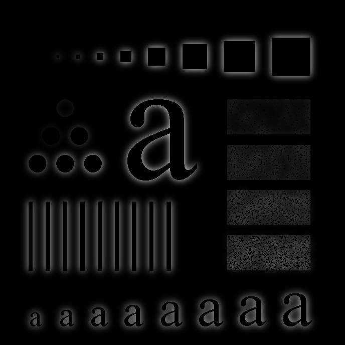

图 04-04-2 将 Part A 的相减高通结果与教材指定参数下的二阶 GHPF `D0=15` 结果放在一起比较。左侧为式 (4.4-14) 的 `original - lowpass(D0=15)`，右侧为直接二阶 GHPF `D0=15`。可以看到两者都突出高频细节，但亮度分布和局部细节强度不同，支持前文关于滤波器阶数差异的解释。

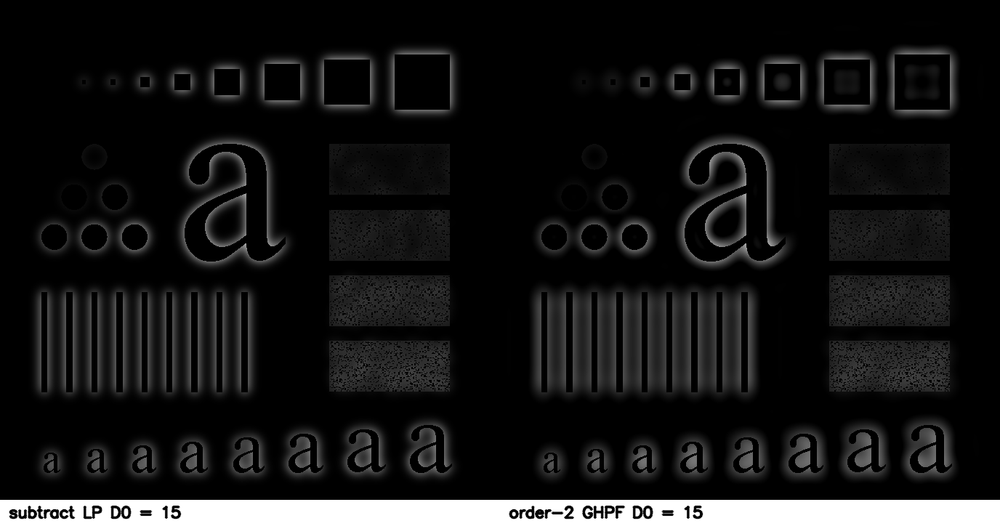

图 04-04-3 为初始参数 `D0=5,15,30,80,230` 的高通结果对比。可以看到 `D0` 较小时高通成分更强，图像较亮；`D0` 很大时结果变弱。初始比较中 `D0=80` 最接近教材目标图。

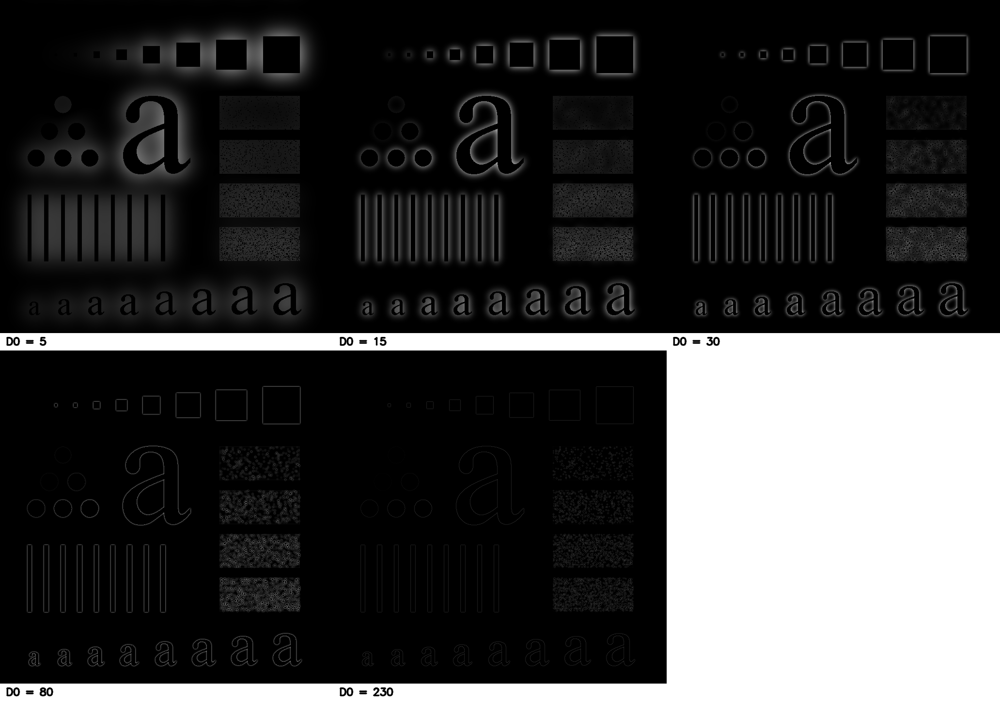

图 04-04-4 为第二轮搜索结果，对 `D0=60,65,70,75,80,85,90` 进行比较。该组结果显示最优区域位于 `D0=70` 附近。

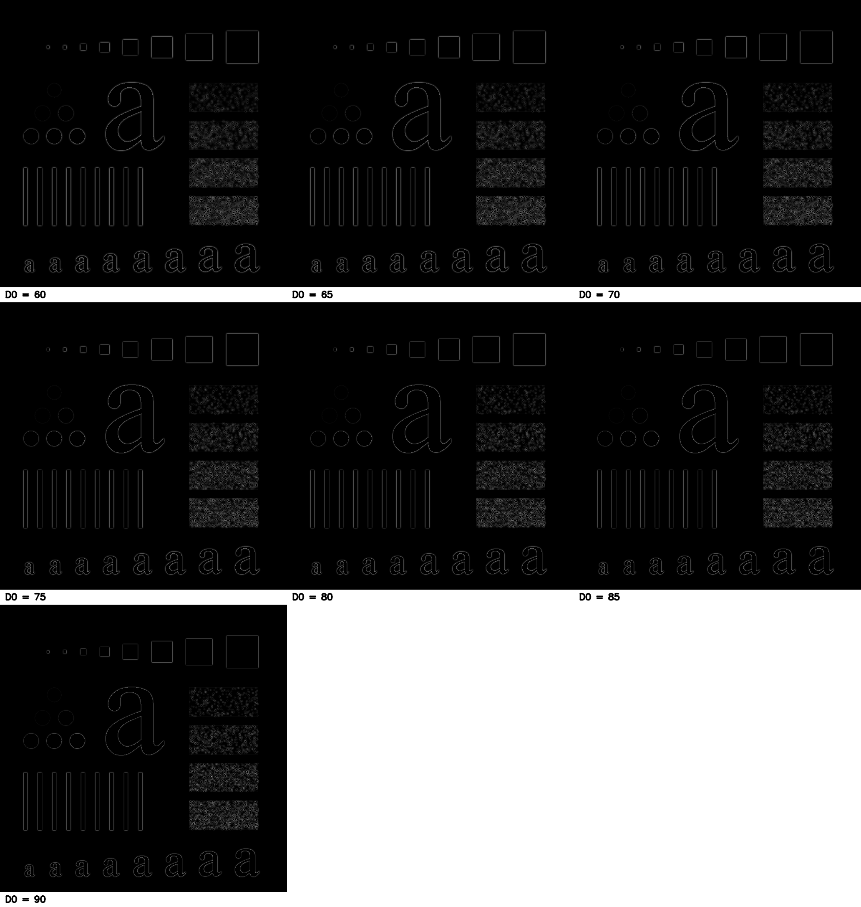

图 04-04-5 为第三轮细调结果，对 `D0=65-75` 逐一比较。该图中多张结果肉眼差异已经较小，因此结合 RMSE、平均绝对差和最大差进行定量判断，最终选取 `D0=70`。

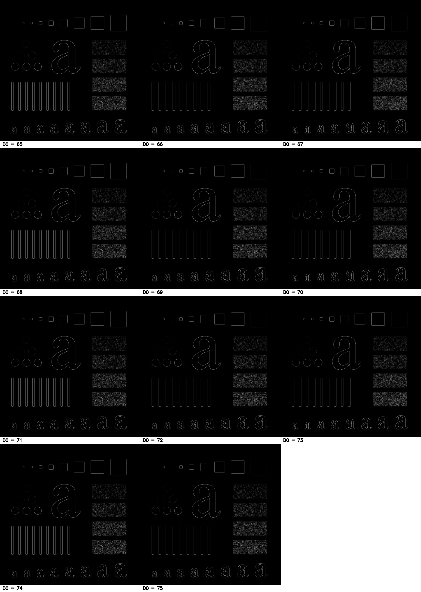

图 04-04-6 为根据教材 Fig. 4.26(c) 参数自行生成的二阶 GHPF `D0=80` 参考图。由于教材截图较模糊，本实验使用该图作为更清晰、可复现的比较目标。


图 04-04-7 为最终最佳参数 `D0=70` 的相减结果与二阶 GHPF `D0=80` 参考图之间的差异放大图，差异被放大 4 倍显示。图中仍有局部灰度差异，说明两者相近但不完全相同。

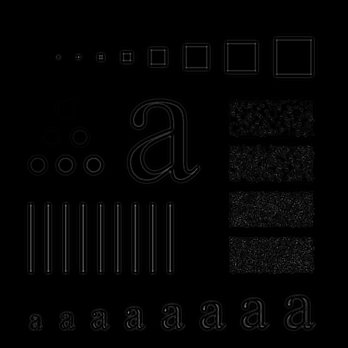

## 创新点及思考

本实验除完成题目要求外，还构造了二阶 GHPF 参考结果，并用像素误差对不同参数进行定量比较。这样可以避免只依赖主观视觉判断。比较结果也验证了一个重要现象：`original - lowpass` 与一阶 GHPF 等价，但与二阶 GHPF 不完全相同；调整 `D0` 可以让二者在视觉和数值上更接近。

## 实验总结

本实验完成了由低通图像构造高通图像的过程，理解了式 (4.4-14) 的含义及其频域解释。实验中最容易混淆的是“相减法高通结果”和“教材二阶 GHPF 直接滤波结果”的关系。通过辅助实现 GHPF 并进行定量对比，可以明确两者差异主要来自滤波器阶数和显示方式。最终在细调参数后，选择 `D0=70` 作为与教材 Fig. 4.26(c) 最接近的相减法参数。

# Project 04-05：Correlation in the Frequency Domain（频率域相关）

## 项目摘要

**摘要**

本实验项目复现例 4.11 的频率域相关过程，用 Fig. 4.41(b) 中的字母"T"定位 Fig. 4.41(a) 中的对应目标。提供的模板截图为 49×44 像素，程序从中裁出 38×42 像素的模板，保留原文件。将 256×256 的图像和裁剪模板分别补零至 298×298 后，计算图像频谱与模板频谱复共轭的乘积，再逆变换得到二维相关函数。所求得的最大相关值约为 21352516，位于从零开始计数的 $(x,y)=(108,107)$。该坐标表示模板左上角，绘制的匹配框覆盖原图中的"T"。空间域逐像素乘积求和也得到相同的峰值，支持实现与坐标解释的正确性。

## 1. 实验题目

### 1.1 实验内容

**在频域中进行相关分析：**

要求使用 Fig. 4.41(a) 的图像和 Fig. 4.41(b) 的模板，复现 Example 4.11 的拓展、频率域相关与结果显示过程，以获得与 Fig. 4.41(e) 对应的二维相关图，标出二维相关函数中最大值所在位置的 (x，y) 坐标，无需在图 4.41(f) 中绘制该分布曲线。

### 1.2 实验目的

- 理解模板平移时相关值如何衡量局部相似程度；
- 理解空间域相关为何可以通过频谱共轭相乘和逆变换实现；
- 准确区分数组索引、模板左上角坐标和图中实际亮笔画的位置。结果是否合理既要看相关峰是否落在"T"，也要检查数值计算与直接空间域求和是否一致。

## 2. 技术讨论

### 2.1 算法原理

#### 2.1.1 模板匹配与图像相关基本原理

本实验以 Fig. 4.41(a) 为输入图像，以 Fig. 4.41(b) 中的"T"为模板，利用二维相关确定模板在图像中的位置。将模板在图像上逐位置移动，在每个位置对模板像素与对应图像像素逐点相乘并求和，得到该位置的相关值。设输入图像为 $f(x,y)$，模板为 $w(m,n)$，模板宽为 $C$、高为 $D$，当模板左上角位于 $(x,y)$ 时，有

$$
r(x,y)=\sum_{n=0}^{D-1}\sum_{m=0}^{C-1}f(x+m,y+n)w(m,n).
$$

式中，$(m,n)$ 是模板内的像素坐标，$(x+m,y+n)$ 是输入图像中对应的像素坐标。相关函数最大值所在的位置为本实验得到的最佳匹配位置。本实验使用原始灰度相关值，输出的 $(x,y)$ 表示**裁剪后的模板左上角**在图像中的位置，坐标原点位于图像左上角，$x$ 为列、$y$ 为行，均从零开始。

#### 2.1.2 频域相关理论

若在空间域直接求取完整相关函数，需要对各个模板位置分别执行逐像素乘积求和。依据傅里叶变换的相关定理，可将这一计算转换为频率域中的逐点乘法，再通过逆变换得到二维相关函数。对零填充后的图像与模板分别求二维傅里叶变换，记其频谱为 $F(u,v)$ 和 $W(u,v)$，则

$$
r(x,y)=\mathcal{F}^{-1}\!\left\{F(u,v)W^{*}(u,v)\right\}.
$$

其中，$F(u,v)$ 为输入图像频谱，$W(u,v)$ 为模板频谱，$W^{*}(u,v)$ 为模板频谱的复共轭。两者在频率域逐点相乘后，经二维逆傅里叶变换得到空间域相关函数。程序取逆变换结果的实部，以消除浮点运算产生的微小虚部。

#### 2.1.3 零填充技术

有限尺寸的 FFT 在未充分补零时产生循环相关，边界处的响应可能周期性绕回并发生混叠。为获得所需的线性相关结果，图像和模板分别放置在零数组的左上角。输入图像宽、高均为 256 像素；原模板截图为 49×44 像素，程序使用半开裁剪框 `(6, 1, 44, 43)` 去除外围黑边，得到宽 $C=38$、高 $D=42$ 像素的模板，原文件不变。

设输入图像宽为 $A=256$、高为 $B=256$。线性相关所需的最小补零尺寸为

$$
P=A+C-1=256+38-1=293 \\
Q=B+D-1=256+42-1=297.
$$

因此，本实验采用宽、高均为 298 像素的零填充数组，同时满足 $P$ 和 $Q$ 的要求。代码中的 `padded_shape=(298, 298)` 按 NumPy 的 `(高度, 宽度)` 顺序表示该尺寸。

#### 2.1.4 基于 FFT 的频域相关算法流程

程序按照以下顺序执行：

1. 读取输入图像 `input/4.41a.jpg` 和模板截图 `input/4.41b.png`，转换为灰度图。
2. 按 `(6, 1, 44, 43)` 裁剪模板，得到 38×42 像素的计算模板。
3. 将输入图像和裁剪后的模板分别置于 298×298 零数组的左上角。
4. 分别进行二维 FFT，获得图像频谱 $F(u,v)$ 和模板频谱 $W(u,v)$。
5. 将 $F(u,v)$ 与 $W^{*}(u,v)$ 逐点相乘。
6. 对乘积进行二维 IFFT，取实部得到二维相关函数。
7. 在原始相关数组中搜索最大值，并将数组的 `(行, 列)` 索引转换为题目所需的 $(x,y)=(列,行)$ 坐标。本次实验得到 $(108,107)$。

### 2.2 实现技术

#### 2.2.1 实验技术实现

- `np.fft.fft2()` 实现二维 FFT；
- `np.conj()` 对模板频谱取复共轭；
- `np.fft.ifft2()` 将频域乘积变换为二维相关函数；
- `np.argmax()` 寻找原始相关数组的最大值，随后由 `np.unravel_index()` 还原二维索引。
- `frequency_correlation` 函数组织补零及频域运算，`main` 函数完成输入预处理和最大值位置提取。
- PNG 相关图仅用于显示；峰值位置从未经显示映射的浮点相关数组中确定。

#### 2.2.2 程序设计与实现

1. `load_grayscale` 使用 Pillow 读取两张输入图并转换为单通道灰度图。程序检查图像为 256×256、裁剪前模板为 49×44，以避免输入文件更换后仍采用不适用的裁剪和补零参数。
2. 从模板截图裁剪出 38×42 的"T"，转换为 `float64` 数组。`frequency_correlation` 检查补零尺寸，将图像与模板分别放入 298×298 零数组的左上角。
3. 对两个数组分别执行 `np.fft.fft2`，把图像频谱与模板频谱的复共轭逐点相乘。执行 `np.fft.ifft2` 并取实部，获得 298×298 的原始相关数组。
4. `np.argmax` 找到原始相关数组的全局最大值，`np.unravel_index` 将一维序号还原为 `(行,列)`，然后写为从零开始的 `(x,y)=(列,行)`。
5. 将原始数组存为 `.npy`，峰值与裁剪参数存为 `.json`，另将相关值映射为 PNG 用于观察。在线性显示图中最大非负值映射为 255，对数显示图则突出弱响应，两者都不改变原始相关值。
6. 以峰值坐标为左上角，按照模板的 38×42 尺寸绘制矩形标记，保存匹配位置图。默认使用 Matplotlib 显示原图、模板、相关图和标注图，`--no-show` 选项仅关闭交互显示。

#### 2.2.3 关键代码展示

以下仅列出 `src/project_04_05.py` 中与算法原理、实验方法对应的核心代码，完整可运行程序见该源文件。

**读取灰度图与裁剪模板**

```python
def load_grayscale(path):
    with Image.open(path) as image:
        return image.convert("L")


image = load_grayscale(arguments.image)
template_original = load_grayscale(arguments.template)
if image.size != (256, 256):
    raise ValueError(f"输入图像应为 256×256 像素，实际为 {image.size}")
if template_original.size != (49, 44):
    raise ValueError(f"裁剪前的模板应为 49×44 像素，实际为 {template_original.size}")

# Pillow 的裁剪框是 (左, 上, 右, 下)，右、下边界不包含在结果中。
template = template_original.crop(TEMPLATE_CROP)
```

`Image.open` 读取文件，`convert("L")` 将其转换为单通道灰度图。`TEMPLATE_CROP` 定义为 `(6, 1, 44, 43)`；`crop` 在内存中生成裁剪结果，不覆盖原始输入文件。尺寸检查确保固定裁剪框适用于当前输入图像。

**补零与频域相关：`frequency_correlation`**

```python
def frequency_correlation(image, template, padded_shape):
    image_array = np.asarray(image, dtype=np.float64)
    template_array = np.asarray(template, dtype=np.float64)
    image_height, image_width = image_array.shape
    template_height, template_width = template_array.shape
    padded_height, padded_width = padded_shape

    if padded_height < image_height + template_height - 1:
        raise ValueError("补零后的高度不足，无法计算线性相关")
    if padded_width < image_width + template_width - 1:
        raise ValueError("补零后的宽度不足，无法计算线性相关")

    # 两幅图都放在左上角，其余位置补零，避免循环相关造成的混叠。
    image_padded = np.zeros(padded_shape, dtype=np.float64)
    template_padded = np.zeros(padded_shape, dtype=np.float64)
    image_padded[:image_height, :image_width] = image_array
    template_padded[:template_height, :template_width] = template_array

    # 相关定理：空间域相关 = 图像频谱乘模板频谱的共轭，再做逆变换。
    image_spectrum = np.fft.fft2(image_padded)
    template_spectrum = np.fft.fft2(template_padded)
    correlation = np.fft.ifft2(image_spectrum * np.conj(template_spectrum)).real
    return correlation, image_padded, template_padded
```

`np.asarray(..., dtype=np.float64)` 将灰度图转换为浮点数组，`shape` 给出高度和宽度。`np.zeros` 分别建立大小为 `padded_shape=(298, 298)` 的零值数组，切片赋值将图像和模板置于各自数组的左上角。函数末尾依次执行两次 `fft2`、模板频谱取共轭并逐点相乘，以及 `ifft2` 逆变换。`.real` 去除数值误差引入的微小虚部；函数同时返回原始浮点相关数组和实际用于 FFT 的两个补零数组。

**寻找峰值并解释坐标**

```python
padded_shape = (298, 298)
correlation, image_padded, template_padded = frequency_correlation(
    image, template, padded_shape
)
peak_y, peak_x = np.unravel_index(np.argmax(correlation), correlation.shape)
peak_x = int(peak_x)
peak_y = int(peak_y)
peak_value = float(correlation[peak_y, peak_x])
```

`np.argmax` 在 298×298 的**原始数组**中找到最大值的一维序号，`np.unravel_index` 将其还原为 `(行,列)`。因此变量先写 `peak_y`、后写 `peak_x`，之后再按 `(x,y)` 输出。`int` 和 `float` 将 NumPy 标量转换为便于打印和写入 JSON 的 Python 数值。

**空间域逐像素求和校验：`verify_spatial_correlation`**

```python
def verify_spatial_correlation(image, template, correlation):
    image_array = np.asarray(image, dtype=np.float64)
    template_array = np.asarray(template, dtype=np.float64)
    template_height, template_width = template_array.shape
    valid_height = image_array.shape[0] - template_height + 1
    valid_width = image_array.shape[1] - template_width + 1
    spatial = np.empty((valid_height, valid_width), dtype=np.float64)

    for row in range(valid_height):
        for column in range(valid_width):
            region = image_array[row:row + template_height, column:column + template_width]
            spatial[row, column] = np.sum(region * template_array)

    spatial_peak_y, spatial_peak_x = np.unravel_index(np.argmax(spatial), spatial.shape)
    max_error = float(np.max(np.abs(spatial - correlation[:valid_height, :valid_width])))
    if not np.allclose(spatial, correlation[:valid_height, :valid_width], rtol=0, atol=1e-6):
        raise ValueError(f"空间域与频域相关结果不一致，最大绝对误差为 {max_error}")
    return int(spatial_peak_x), int(spatial_peak_y), float(spatial[spatial_peak_y, spatial_peak_x]), max_error
```

该函数只对模板完全位于原图内的有效位置逐点计算空间域相关，再与 FFT 结果的相应区域比较。它是频域计算后的独立校验，不是本项目要求的频域相关算法。主程序还检查两种方法得到的最大值坐标是否相同，并将空间域峰值和最大绝对误差写入 `04_05_peak.json`。

**相关结果可视化：`display_correlation`**

```python
def display_correlation(correlation, logarithmic=False):
    # 仅为显示映射到 0–255；峰值定位仍使用原始浮点相关数组。
    nonnegative = np.maximum(correlation, 0)
    peak_value = nonnegative.max()
    if peak_value == 0:
        return Image.fromarray(np.zeros(correlation.shape, dtype=np.uint8))
    if logarithmic:
        scaled = np.log1p(nonnegative) / np.log1p(peak_value)
    else:
        scaled = nonnegative / peak_value
    return Image.fromarray(np.round(255 * scaled).astype(np.uint8))
```

图像文件需要可显示的灰度范围，这个函数先把负响应截为 0，再把最大非负值缩放为 255。`logarithmic=True` 时使用对数映射，便于看到较弱响应。这是**显示处理**，不用于求峰值，也不会修改 `correlation` 原数组。

**保存结果与标注匹配位置**

```python
arguments.results.mkdir(parents=True, exist_ok=True)
correlation_display = display_correlation(correlation)
template.save(arguments.results / "04_05_template_cropped.png")
Image.fromarray(image_padded.astype(np.uint8)).save(arguments.results / "04_05_image_padded.png")
Image.fromarray(template_padded.astype(np.uint8)).save(arguments.results / "04_05_template_padded.png")
correlation_display.save(arguments.results / "04_05_correlation_display.png")
display_correlation(correlation, logarithmic=True).save(arguments.results / "04_05_correlation_log_display.png")
np.save(arguments.results / "04_05_correlation.npy", correlation)

marked = image.convert("RGB")
draw = ImageDraw.Draw(marked)
draw.rectangle((peak_x, peak_y, peak_x + template.width - 1, peak_y + template.height - 1),outline="red",width=2,)
marked.save(arguments.results / "04_05_match_location.png")
```

`.npy` 文件保存完整浮点相关数组，PNG 文件用于结果展示。两张延拓图直接由参与 FFT 的补零数组转换为 8 位灰度图保存，不额外裁剪或缩放。矩形标记以峰值坐标为左上角，其宽度和高度等于裁剪模板的实际尺寸；绘制彩色标记前将原图转换为 RGB 格式。

最后将结果在交互窗口中弹窗展示，输出相关函数最大值位置坐标和最大值，并将结果保存到`results/`目录下。

#### 2.2.4 实验环境

- 操作系统：Windows。
- 编程语言及版本：Python 3.12.7。
- 使用的库及版本：NumPy 1.26.4、Pillow 10.4.0、Matplotlib 3.10.0。
- 输入图像及来源：项目提供的 Fig. 4.41(a) 图像和 Fig. 4.41(b) 模板截图。模板截图与例题标称尺寸不一致，因此记录了程序裁剪步骤。
- 输出文件名称与格式：`results/04_05_*.png` 为展示图，`04_05_correlation.npy` 为完整浮点相关数组，`04_05_peak.json` 记录输入、裁剪、补零与最大值信息。

## 3. 结果讨论

### 3.1 结果展示

图 04-05-1、04-05-2 展示原图和裁剪模板，图 04-05-3、04-05-4 展示分别补零至 298×298 后实际参与 FFT 的图像与模板，对应例 4.11 的延拓步骤。图 04-05-5 至 04-05-7 展示相关函数及峰值位置。延拓图只保存至结果目录，不在程序运行后的四图窗口中显示。图注中的尺寸为文件的实际像素尺寸，交互窗口中的模板图像经过显示缩放，算法输入时仍保持 38×42 像素。精确相关值以 `results/04_05_peak.json` 和 `results/04_05_correlation.npy` 为准。

- 图 04-05-1：输入图像 Fig. 4.41(a)，256×256 像素。
  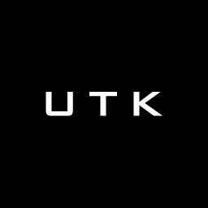
- 图 04-05-2：由 Fig. 4.41(b) 截图裁剪的 38×42 模板。
  
- 图 04-05-3：输入图像左上角对齐并补零后的 298×298 灰度图，其余区域为零。
  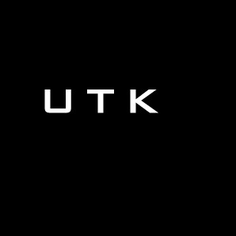
- 图 04-05-4：裁剪模板左上角对齐并补零后的 298×298 灰度图，其余区域为零。
  
- 图 04-05-5：298×298 二维相关函数，非负值相对峰值线性映射到 0–255。
  
- 图 04-05-6：原图上的峰值位置与模板大小标注，标注框从最大值位置框选模板在原图匹配位置。
  
- 图 04-05-7：对数映射的相关函数辅助观察图。
  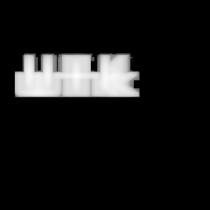

### 3.2 结果分析

**峰值与定位：** 二维相关数组尺寸为 298×298。全局最大值约 21352516，坐标为 $(108,107)$；将模板的左上角放在此处，可以看到 38×42 的标注框覆盖原图中的"T"。因此本次定位与例题对最高峰位于"T"顶部附近的描述一致。峰值坐标是相关函数数组的索引，也代表该模板左上角的放置位置。

**数值校验：** 程序中的 `verify_spatial_correlation` 对原图中所有允许模板完全放置的位置直接执行逐像素乘积求和。空间域相关函数的最大值为 21352516，坐标为 $(108,107)$；FFT 数组在该点的值约为 21352516。两个有效区域逐点比较的最大绝对误差约为 $1.49\times10^{-8}$，属于浮点运算误差。这既检查了峰值，也检查了有效区域的索引方向与频域公式，是对**现有输入和实现**的一致性验证。校验数值记录在 `results/04_05_peak.json` 中。

**显示与参考图：** 线性显示图中，"T"所在区域形成最明显的响应；对数显示图放大较弱了响应，也能看到其他字母附近的相关结构。两张显示图都把负值截为零，并对非负值作可视化映射，因此图上的灰度不等于原始相关值。与 Fig. 4.41(e) 对比，可以核对峰值所在对象及总体形态，经核对对比及上述多重校验可判断，此实验所得结果是正确的。

## 4. 创新点及思考

**独立验证与可复现记录：** 在题目要求的相关图和峰值坐标之外，我保留了原始相关数组与 JSON 参数记录，并通过空间域逐像素求和交叉验证频域结果的正确性。两种计算路径在有效区域内达到浮点误差量级的一致性，这样做便于发现共轭遗漏、行列颠倒或填充不足等实现问题。

**验证依据的适用范围：** 匹配位置标记覆盖目标区域，说明模板定位结果在视觉上与预期一致，但该结果只能验证匹配位置的合理性，不能单独证明相关函数计算过程正确。由于相关函数可能存在其他局部峰值，还需要进一步确认最大值来源于原始相关数组，而非归一化或增强后的显示图像。在满足零填充条件下，根据傅里叶相关定理，空间域直接计算得到的相关函数应与通过 FFT 频域乘法并逆傅里叶变换得到的相关函数保持一致。因此，本实验中视觉核对主要用于验证定位结果，数值校验用于验证相关计算过程。

**此方法的局限与可继续探索的问题：** 当前采用未归一化灰度相关，相关值直接由像素乘积累加得到，因此对图像整体亮度变化较为敏感，当其他区域具有较高平均灰度时可能产生较大的相关响应。此外，该方法依赖模板与目标区域之间的像素对应关系，当目标发生旋转、缩放或笔画变化时，匹配峰值可能降低。因此考虑后续可以进一步引入零均值归一化相关方法，比较不同亮度条件下的匹配鲁棒性，同时研究不同模板裁剪范围对匹配位置和相关峰值的影响。

## 5. 实验总结

本实验利用傅里叶变换的相关定理实现了图像与模板的二维相关，并通过相关函数的最大值确定了模板在输入图像中的位置。所得结果与原图中"T"的位置一致，空间域计算也验证了频域结果的数值正确性。通过本实验，我进一步理解了零填充、频谱复共轭相乘和逆变换在频域相关中的作用，也认识到相关峰值与模板匹配位置之间的关系。

## 附录：程序清单与运行说明

- 程序文件/清单：`src/project_04_05.py`。
- 运行入口及命令：在 `project_04_05/` 目录运行 `python src/project_04_05.py`，结果保存后弹出四图窗口；无界面运行可加 `--no-show`。
- 输入图像与模板：`input/4.41a.jpg`、`input/4.41b.png`。
- 输出图像及数据：运行后写入 `results/`。裁剪模板、两张补零延拓图、线性相关图、对数相关图和匹配标注图为 PNG；完整相关数组为 `.npy`；坐标和参数为 `.json`。
- 关键参数及复现步骤：安装 `requirements.txt` 所列依赖，保持两张输入图在 `input/`，在本目录执行上述命令。程序用裁剪区域 `(6, 1, 44, 43)` 得到 38×42 模板，补零至 298×298，再输出结果；无需手动裁图。重新运行会从原始模板开始处理并更新 `results/` 中的输出。
- 核查方式：运行程序时会自动执行空间域校验。检查 `results/04_05_peak.json` 中的 `peak_xy_zero_based` 与 `spatial_peak_xy_zero_based` 是否均为 `[108, 107]`，以及 `spatial_fft_max_absolute_error_valid_region` 是否接近零；同时确认匹配位置标记覆盖“T”。JSON 中记录的结果路径是运行时的绝对路径，在其他设备上复现时应以项目目录下的实际文件位置为准。
