# 数字图像处理课程实验报告

## 实验项目封面

**课程名称：** 数字图像处理

**实验项目：**

- **Project 04-03：** Gaussian Lowpass Filtering（高斯低通滤波）
- **Project 04-04：** Highpass Filtering Using a Lowpass Image（使用低通图像的高通滤波）
- **Project 04-05：** Correlation in the Frequency Domain（频率域相关）

**小组成员：**

- 唐咏妍，24325241
- 刘思含，24325185
- 李可，24325140

**截止日期：** 2026年10月14日　　**提交日期：** 2026年10月14日

## 小组成员分工及贡献

- **李可：** 主要负责公共图像处理基础框架及 Project 04-03 的代码实现、结果整理和实验分析；参与 04-04、04-05 的程序复现、公共接口测试、图像处理流程核对，并协助检查实验参数和结果是否符合题目要求。
- **唐咏妍：** 主要负责 Project 04-04 的算法实现、参数或条件对比实验及结果分析；同时参与 04-03 和 04-05 的运行验证、结果对照和问题反馈，验证实验过程是否正确合理，协助完善实验现象说明、参数记录及报告中的技术分析。
- **刘思含：** 主要负责 Project 04-05 的算法分析、程序实现、结果验证和实验分析；参与 04-03、04-04 算法和程序的复现与交叉检查，核对参数对比表，收集和核对各项目的代码、结果图及说明材料，完成三项实验的统一整合、报告排版、贡献说明和最终检查。
- **共同协作：** 三位成员互相复现运行结果，核对算法实现，核对输入、参数、输出图像和实验结论，并共同完善实验报告的格式、图表引用、结果分析与提交材料，确保报告内容与实际程序实现相互对应。

# Project 04-03：Gaussian Lowpass Filtering（高斯低通滤波）

## 摘要

本实验构造了二维高斯低通滤波器，并对 688×688 的字符测试图进行频域滤波。滤波器函数可以指定尺寸和中心，处理图像时，中心取为 `fftshift` 后的直流位置。实验过程中，使用的控制滤波器宽度的参数分别为 $D_0=5$、$15$、$30$、$80$、$230$，这里不进行零填充。其中 $D_0=15$ 时得到的结果对应 Fig. 4.18(c)：大字符与方块仍可辨认，细线、小字符和随机纹理则明显变模糊。随着 $D_0$ 增大，更多细节得以保留。

## 1. 实验题目

### 1.1 实验内容

**低通滤波**

1. 实现式 (4.3-7) 中的高斯低通滤波器，必须能够指定所得二维函数的尺寸 M × N，以及高斯函数中心的二维位置；
2. 下载图 4.11(a) ，并对其应用低通滤波，得到图 4.18(c)。

### 1.2 实验目的

- 实现可指定尺寸、中心位置和截止频率参数的二维高斯低通滤波器；
- 掌握利用频域乘法完成图像平滑处理的方法；
- 通过不同参数对比，理解低频轮廓、高频细节与平滑程度之间的关系。

## 2. 技术讨论

### 2.1 算法原理与实现技术

二维离散傅里叶变换为

$$
F(u,v)=\sum_{x=0}^{M-1}\sum_{y=0}^{N-1}f(x,y)e^{-j2\pi(ux/M+vy/N)}
$$

采用 `fftshift` 将直流项移到频谱中央。高斯低通响应为

$$
H(u,v)=\exp[-D^2(u,v)/(2D_0^2)],\quad D^2(u,v)=(u-u_c)^2+(v-v_c)^2.
$$

式中 $M$、$N$ 分别是图像的行数和列数，$(u_c,v_c)$ 是滤波器中心，代码中的 `center` 按 `(行, 列)` 传入。

$D_0$ 越小，频域响应越集中在中心，图像平滑越明显。高斯响应从中心向外逐渐衰减，并没有理想低通滤波器那样的硬边界。在 $D=D_0$ 处，响应为 $e^{-1/2}\approx0.607$。

频域滤波及反变换为

$$
G=F_c H,\qquad g=\mathrm{Re}(\mathrm{IFFT2}(\mathrm{ifftshift}(G)))
$$

$F_c$ 表示 `fftshift` 后的频谱。滤波器中心取 $(\lfloor M/2\rfloor,\lfloor N/2\rfloor)$，本实验所用的图像为 688×688，因此中心是 $(344,344)$。程序用 `ifftshift` 将相乘后的频谱移回原位置，再进行逆变换。

设计的主实验没有使用零填充，FFT 对图像采用周期边界。程序算法中另外提供零填充选项：可以先将图像补到 $2M\times2N$，滤波后再截取原尺寸。由于补零会改变频率网格，因此这两种设置下相同的 $D_0$ 不能直接作为同一滤波强度进行比较。

输入图像按 255 归一化到 $[0,1]$。计算结果保存为浮点 `.npy`，供 04-04 的高通实验使用，PNG 保存时才将数值限制在 $[0,1]$ 并转换为 8 位灰度。频谱图显示的是 $\log(1+|F|)$，输入与五组输出使用相同的显示范围 $[0,12.860555]$，这样便于直接比较亮度变化。

### 2.2 程序设计与实现

1. `common_io.read_gray` 读取图像，RGB 经灰度转换，8/16 位无符号灰度按各自位深归一化；
2. `gaussian_lowpass(shape,d0,center)` 根据频率坐标构造高斯响应，并检查尺寸和 $D_0$；
3. `apply_frequency_filter` 执行 FFT、频谱中心化、逐点相乘及逆移位反变换，保留复数逆变换结果；
4. `filter_image` 构造以直流为中心的低通响应，记录逆变换的虚部残差，再提取实部；
5. 主程序完成五组参数实验，保存原图、频谱、响应、输出、对比图及浮点数组；
6. CSV 和 JSON 保存参数、图像哈希、运行环境及数值指标，方便核对实验记录。

为检查尺寸和中心参数，另生成了 180×240、中心为 `(60, 160)`、$D_0=15$ 的响应（图 04-03-6）。这个图只展示滤波器形状，没有用于处理字符图像。图像滤波仍将中心放在直流位置，底层函数保留复数逆变换结果，以便检查虚部。

### 2.3 关键代码展示

```python
def gaussian_lowpass(shape, d0, center=None):
    valid_shape = len(shape) == 2 and all(
        isinstance(size, (int, np.integer)) and size > 0 for size in shape
    )
    if not valid_shape or not np.isfinite(d0) or d0 <= 0:
        raise ValueError("shape and d0 must be positive")
    if center is None:
        center = (shape[0] // 2, shape[1] // 2)
    row, col = np.ogrid[:shape[0], :shape[1]]
    return np.exp(-0.5 * (((row - center[0]) / d0) ** 2 + ((col - center[1]) / d0) ** 2))


def apply_frequency_filter(image, response):
    spectrum = np.fft.fftshift(np.fft.fft2(image))
    filtered = spectrum * response
    inverse = np.fft.ifft2(np.fft.ifftshift(filtered))
    return spectrum, filtered, inverse


def filter_image(image, d0, padding=False):
    height, width = image.shape
    padded = np.pad(image, ((0, height), (0, width))) if padding else image
    response = gaussian_lowpass(padded.shape, d0)
    spectrum, filtered, inverse = apply_frequency_filter(padded, response)
    residual = float(np.max(np.abs(inverse.imag)))
    return inverse.real[:height, :width], response, spectrum, filtered, residual
```

上述代码对应实验的主要计算流程：首先根据频率坐标构造高斯低通响应，然后对输入图像进行二维 FFT，将频谱与滤波器逐点相乘，最后通过逆 FFT 得到滤波结果。`fftshift` 和 `ifftshift` 使滤波器中心与频谱中的直流分量位置一致，`residual` 记录理论上应为实数的结果中残留的虚部。主实验的 `padding` 为 `False`，输出截取原图尺寸。

多组截止频率的实验在主程序中循环完成，并分别保存浮点结果和用于显示的 PNG 图像：

```python
for d0 in d0_values:
    output, H, F, G, residual = filter_image(image, d0, padding)
    label = f"{d0:g}".replace(".", "p")
    save_gray(H, output_dir / f"04_03_filter_d0_{label}.png")
    G_display = normalize_display(np.log1p(np.abs(G)), spectrum_limits)
    save_gray(G_display, output_dir / f"04_03_filtered_spectrum_d0_{label}.png")
    save_gray(output, output_dir / f"04_03_output_d0_{label}.png")
    np.save(output_dir / f"04_03_lowpass_d0_{label}.npy", output)
```

这个循环对应五组 $D_0$ 参数的结果生成，`.npy` 文件保留未量化的浮点结果，PNG 文件用于可视化展示。

### 2.4 实验环境

- 系统：Windows。
- 环境：Python 3.10.21、NumPy 2.2.5、Pillow 11.1.0。
- 输入：688×688、8 位灰度 TIF，处理范围为 [0,1]。
- FFT 尺寸：688×688，中心 (344,344)。
- 参数：D₀=5、15、30、80、230，目标图 (c) 使用的是 D₀=15。
- 输出：8 位 PNG、float64 NPY、CSV 指标表和 JSON 元数据。

## 3. 结果讨论

### 3.1 结果分析

图 04-03-5 将原图和五组滤波结果排在一起。$D_0=5$ 时，字符和竖线严重模糊，右侧纹理几乎看不清。$D_0=15$ 时，大字符和方块轮廓还能辨认，但小字符、竖线边缘及随机纹理明显变模糊，这与 Fig. 4.18(c) 展示的平滑效果相近。

$D_0$ 增至 30 后，竖线和小字符逐渐清楚，$D_0$ 取 80 和 230 时，边缘和纹理进一步接近原图。图 04-03-3 中的滤波器响应随 $D_0$ 增大而变宽，图 04-03-4 中较远离中心的频率分量也随之增强，这些结果与图像细节逐渐恢复的现象一致。

下表由保存前的浮点输出计算，RMSE 为相对原图的均方根差，仅衡量滤波造成的变化。

| D₀ | 均值     | 标准差   | 相对原图 RMSE | 梯度能量保留比例 % |
| --- | -------- | -------- | ------------- | ------------------ |
| 5   | 0.812999 | 0.115621 | 0.230930      | 0.032              |
| 15  | 0.812999 | 0.178088 | 0.178927      | 0.408              |
| 30  | 0.812999 | 0.211232 | 0.144403      | 1.500              |
| 80  | 0.812999 | 0.241806 | 0.106900      | 6.384              |
| 230 | 0.812999 | 0.262083 | 0.048175      | 36.853             |

梯度能量按周期边界下水平和垂直一阶差分的平方和取均值，表中比例是滤波结果相对原图的百分比，原图均值为 0.812999、标准差为 0.277305。五组输出均值相同，因为滤波器在直流位置的响应为 1。

随着 $D_0$ 增大，标准差和梯度能量的保留比例升高，RMSE 降低，这与图 04-03-5 的变化相符。$D_0=15$ 的梯度能量保留比例为 0.408%，说明细节变化被明显削弱。

五组反变换的虚部残差最大为 $4.15\times10^{-16}$，可以判断是属于浮点误差。七项测试分别检查了自定义尺寸和中心、奇偶尺寸的均值保持、正弦波衰减、与直接循环卷积的一致性、偏离中心时的复数结果、图像读写，以及非法参数和填充后的尺寸。

与教材图的比较采用直接的视觉观察，结果图直接来自对所给 TIF 的处理输出，没有额外做对比度拉伸。

### 3.2 结果图

图 04-03-1 原始字符测试图，输入 TIF 转为 PNG，固定 [0,1] 灰度显示。

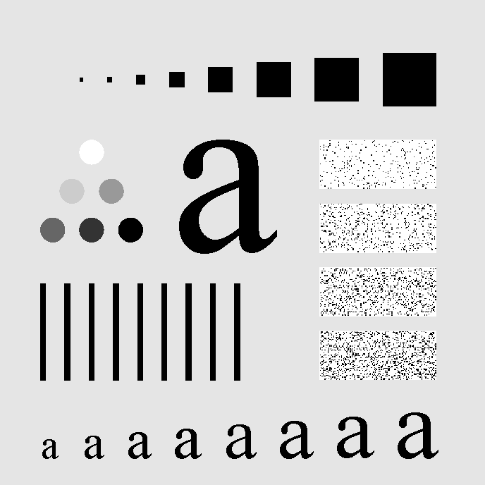

图 04-03-2 为输入中心化频谱，显示 log(1+|F|)，对数幅值范围 [0,12.860555]，中心为 (344,344)。

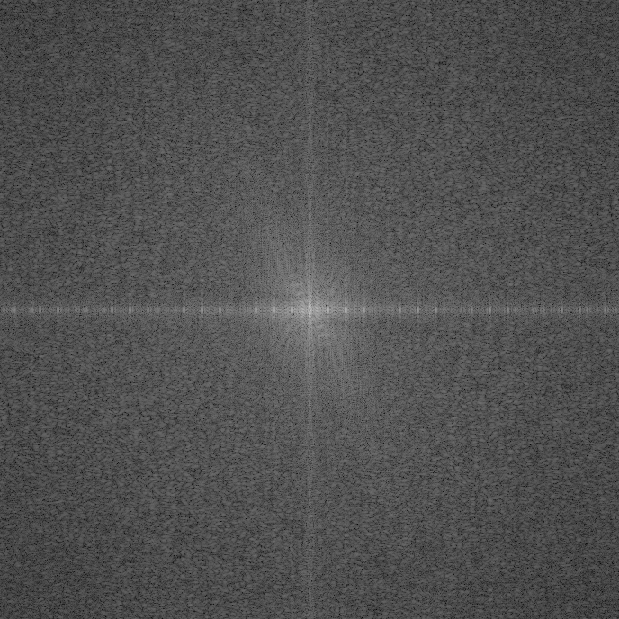

图 04-03-3(a) 至 (e) 为高斯低通响应，D₀ 依次为 5、15、30、80、230。原始响应尺寸均为 688×688，固定 [0,1] 显示，这里仅为排版缩小，单独 PNG 保留原始尺寸。

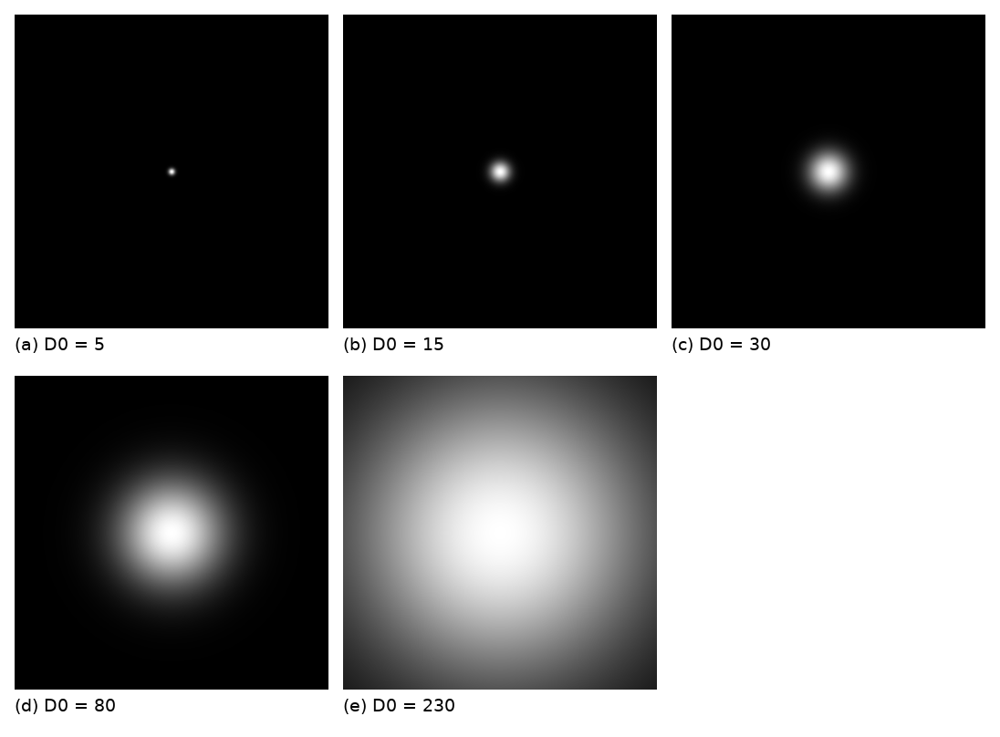

图 04-03-4(a) 至 (e) 为滤波后中心化频谱，参数与图 04-03-3 一致，全部与输入频谱共用对数幅值显示范围。

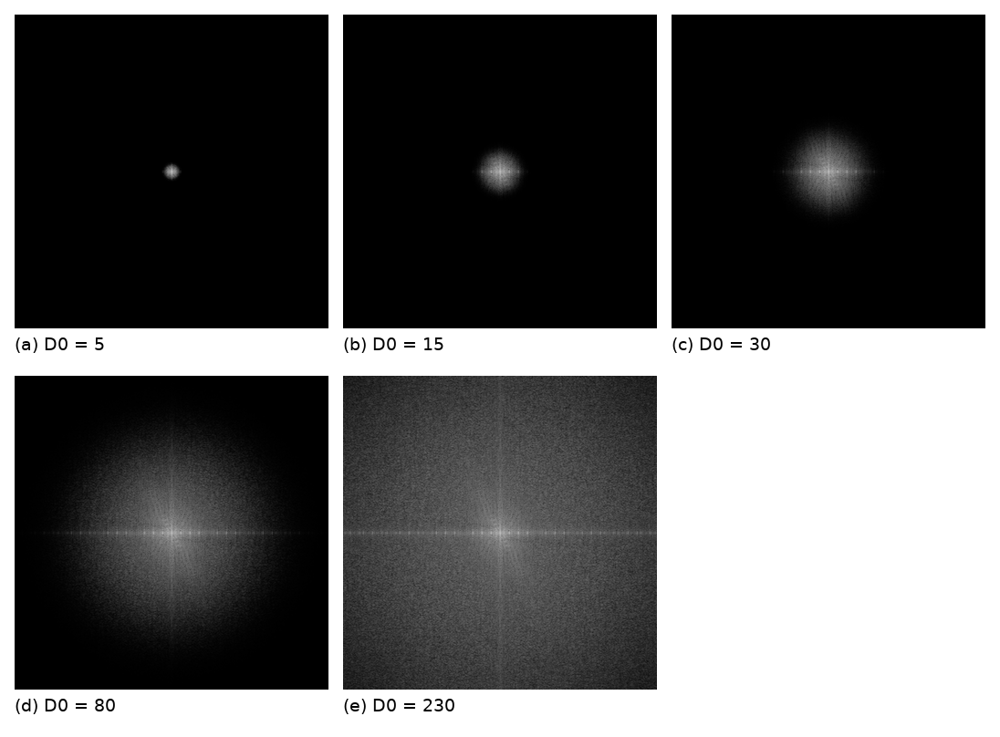

图 04-03-5(a) 为原图，(b) 至 (f) 分别为 D₀=5、15、30、80、230 的输出，(c) 为目标结果。

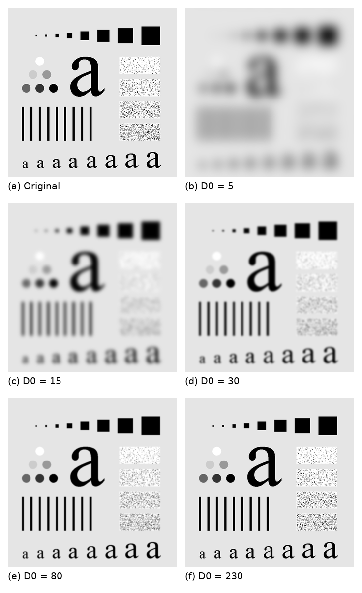

图 04-03-6 为指定尺寸与中心的滤波器示例，响应尺寸为 180×240，中心 (60,160)，D₀=15。

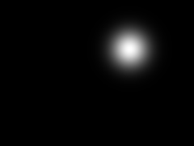

## 4. 创新点及思考

除题目要求的高斯滤波器和字符图像实验外，本实验还额外尝试生成了一个非默认中心的滤波器，用来检查 `center` 参数是否生效。绘制频谱图时统一了显示范围，避免每张图单独拉伸后难以比较。滤波结果同时保存为 `.npy`，供项目 04-04 直接进行浮点减法。

从五组结果看，$D_0$ 较小时，细小纹理与竖线边缘一同被抑制；$D_0$ 较大时，细节得到保留，平滑效果也减弱，因此参数要按目标效果来进行选择。本次取 $D_0=15$ 主要是为了复现参考图，并不代表它对其他图像也适合。

同时，本次主实验采取未填充、图像边界按周期方式处理的方法，因此边缘附近的结果是与这个条件有关的，之后如果按照别的方式去处理，边缘结果可能会有所不同。

## 5. 实验总结

本实验完成了高斯低通滤波器的构造与字符图像的频域平滑，通过比较不同参数下的结果，认识到滤波器参数对图像平滑程度和细节保留的影响。实验结果与理论分析基本一致，说明算法程序正确实现了预期的平滑效果。通过本次实验，我们加深了对频域滤波过程的理解，也认识到参数选择应结合具体图像和处理目标。

# Project 04-04：Highpass Filtering Using a Lowpass Image（使用低通图像的高通滤波）

## 摘要

本实验利用 Project 04-03 中已经实现的高斯低通滤波函数，按照式 (4.4-14) 用原图减去低通图像，得到图像的高频成分。实验首先使用 Project 04-03(b) 对应的低通结果，即 `D0=15`，生成高通图像；随后调整低通滤波器参数，比较不同 `D0` 下相减结果与教材 Fig. 4.26(c) 所示二阶 GHPF 高通图像的相似程度。实验中保留 `.npy` 浮点结果作为真实计算数据，并将高通结果裁剪到 `[0,1]` 后转换为 8 位 PNG 进行显示。初始参数组中 `D0=80` 最接近教材目标图；第二轮在 `D0=60-90` 附近粗调后发现 `D0=70` 最接近；第三轮在 `D0=65-75` 区间以步长 1 细调，最终 `D0=70` 的 RMSE 最小，因此选为最接近目标图像的参数。

## 1. 实验题目

### 1.1 实验内容

本项目要求利用低通图像构造高通图像。设原图为 `f(x,y)`，Project 04-03 得到的低通图像为 `f_lp(x,y)`，则高通图像按式 (4.4-14) 计算：

$$
f_{hp}(x,y)=f(x,y)-f_{lp}(x,y)
$$

### 1.2 实验目的

1. 复用成员 A 在 Project 04-03 中提供的 `filter_image` 函数，得到高斯低通图像。
2. 用原图减低通图，分离字符测试图中的边缘、细线和纹理等高频成分。
3. 解释该相减结果与教材 Fig. 4.26 中直接二阶 GHPF 高通滤波结果不完全相同的原因。
4. 调整低通滤波参数，寻找与教材 Fig. 4.26(c) 最接近的相减结果。

## 2. 技术讨论

### 2.1 算法原理与实现技术

Project 04-03 使用的高斯低通滤波器为：

$$
H_{LP}(u,v)=\exp\left[-\frac{D^2(u,v)}{2D_0^2}\right]
$$

其中 `D0` 控制低通滤波器的频率尺度。由低通图像相减得到的高通结果在频域上可写为：

$$
F_{HP}(u,v)=F(u,v)-H_{LP}(u,v)F(u,v)
          =[1-H_{LP}(u,v)]F(u,v)
$$

因此相减法等效于使用 `1-H_LP(u,v)` 作为高通响应。实验中真实高通数组可能包含负值，所以不能直接当作普通 `[0,1]` 灰度图保存。本实验将真实结果保存为 `.npy`，显示图则采用：

```python
display = (np.clip(highpass, 0, 1) * 255).astype(np.uint8)
```

即负值显示为黑色，正值按亮度显示。该显示方式与教材高通图的暗背景视觉风格更接近。

教材 Fig. 4.26(c) 标注为 `order 2, D0=80` 的 GHPF 结果。由于教材和课件中给出的截图分辨率较低、印刷噪声较明显，直接拿截图做像素级比较不够可靠。为了获得更清晰、可复现的参考图，本实验在程序中额外编写二阶高斯高通滤波函数，生成 `D0=15,30,80` 的直接 GHPF 结果，用作参数调整和误差对比的参考目标。

二阶 GHPF 采用的形式为：

$$
H_{GHPF}(u,v)=1-\exp\left[-\frac{1}{2}\left(\frac{D^2(u,v)}{D_0^2}\right)^n\right]
$$

其中 `n=2`。对比验证表明，`original - lowpass` 与一阶 GHPF 在相同 `D0` 下完全一致；但与二阶 GHPF 存在差异，这说明阶数会改变过渡带形状和最终高通亮度分布。

为直观解释这种差异，程序还绘制了一阶与二阶高斯高通的归一化径向频率响应。令 (r=D/D_0)，则两种响应分别为：

$$
H_1(r)=1-exp(-0.5 r^2),   H_2(r)=1-exp(-0.5 r^4).
$$

输出图 `results/project_04_04/04_04_gaussian_highpass_order_comparison.png` 包含两个子图：左图显示线性幅度响应，右图显示 (20log_{10}|H_{HP}|) 的 dB 衰减。横轴为归一化频率 (D/D_0)，虚线 (D/D_0=1) 标记归一化截止位置。

### 2.2 程序设计与实现

程序文件为 `src/project_04_04.py`。其中主实验部分完成原图减低通图的高通计算；参考图生成部分用于构造教材 Fig. 4.26 对应的二阶 GHPF 对比图。

主程序流程如下：

1. 使用 `read_gray` 读取 `input/Fig0441(a)(characters_test_pattern).tif`，得到 `[0,1]` 范围的二维浮点灰度图。
2. 调用 `filter_image(original, d0=15)` 得到 Project 04-03(b) 对应的低通图像。
3. 计算 `highpass = original - lowpass`，保存 `results/project_04_04/04_04_part_a_highpass_d0_15.npy` 和显示图。
4. 使用初始参数组 `D0 = 5, 15, 30, 80, 230` 生成多组高通结果和对比图。
5. 根据初始结果，先用 `D0 = 60, 65, 70, 75, 80, 85, 90` 在 `D0=80` 附近进行第二轮搜索。
6. 根据第二轮结果，再在 `D0=65-75` 区间以步长 1 进行第三轮细调。
7. 将每组高通结果保存为 `.npy` 和 PNG，并生成 `04_04_highpass_comparison.png`、`04_04_highpass_comparison_2.png`、`04_04_highpass_comparison_3.png`。
8. 调用 `save_order_response_comparison`，生成一阶与二阶 GHPF 的线性响应和 dB 衰减对比图。

### 2.3 关键代码展示

```python
original = read_gray(INPUT)
lowpass, *_ = filter_image(original, d0=15)
highpass = original - lowpass
np.save("results/project_04_04/04_04_part_a_highpass_d0_15.npy", highpass)
cv2.imwrite("results/project_04_04/04_04_part_a_highpass_d0_15.png", highpass_to_u8(highpass))
```

```python
for d0 in D0_VALUES:
    lowpass, *_ = filter_image(original, d0=d0)
    highpass = original - lowpass
    label = f"{d0:g}"
    np.save(f"results/project_04_04/04_04_highpass_d0_{label}.npy", highpass)
    cv2.imwrite(f"results/project_04_04/04_04_highpass_d0_{label}.png", highpass_to_u8(highpass))
```

显示转换函数为：

```python
def highpass_to_u8(highpass):
    return (np.clip(highpass, 0, 1) * 255).astype(np.uint8)
```

频率响应对比图由以下函数生成：

```python
def save_order_response_comparison(path, max_normalized_frequency=4.0, samples=1200):
    r = np.linspace(0, max_normalized_frequency, samples)
    first_order = 1 - np.exp(-0.5 * r ** 2)
    second_order = 1 - np.exp(-0.5 * r ** 4)
    first_order_db = 20 * np.log10(np.maximum(first_order, 1e-12))
    second_order_db = 20 * np.log10(np.maximum(second_order, 1e-12))
    # 分别绘制线性响应和 dB 衰减，并在 r=1 处标记 D0。
```

### 2.4 实验环境

- 操作系统：Windows 11。
- 编程语言：Python 3.12。
- 使用库：NumPy、Pillow、OpenCV。
- 输入图像：`input/Fig0441(a)(characters_test_pattern).tif`，688×688 灰度字符测试图。
- 低通滤波器：复用 Project 04-03 的高斯低通滤波函数 `filter_image`。
- 高通计算公式：`highpass = original - lowpass`。
- 显示方式：负值截断为 0，正值映射到 8 位灰度。
- 主要输出：`results/project_04_04/04_04_highpass_d0_*.png`、`results/project_04_04/04_04_highpass_d0_*.npy`、`results/project_04_04/04_04_highpass_comparison.png`、`results/project_04_04/04_04_highpass_comparison_2.png`、`results/project_04_04/04_04_highpass_comparison_3.png`、`results/project_04_04/04_04_gaussian_highpass_order_comparison.png`。

## 3. 结果讨论

### 3.1 Part A：为什么相减结果与 Fig. 4.26 不完全相同

使用 `D0=15` 的低通图像与原图相减后，能够得到边缘、细线、小字符和纹理等高频信息。但该结果与教材 Fig. 4.26 中直接 GHPF 的结果不完全相同。该现象的最主要原因是两者对应的高通滤波器频率响应不同，其他实现和显示因素也会进一步影响视觉效果。

最主要的原因是滤波器形式不同。Project 04-03 中的低通滤波器是普通高斯低通，相减后等效于 `1-H_LP(u,v)`，即一阶形式的高斯高通响应。教材 Fig. 4.26 使用的是 `order 2` 的 GHPF。阶数会改变高通滤波器在截止频率附近的过渡形状和频率衰减特性，因此即使 `D0` 相同，输出图像的亮度分布、细节强度和过渡效果仍会存在差异。这是相减结果与教材直接 GHPF 结果不完全一致的核心原因。

其次，显示方式是一个辅助影响因素。高通结果本身包含正值和负值，而普通 PNG 图像只能保存非负灰度值。为了接近教材高通图的暗背景显示效果，本实验采用截断显示，即将负值显示为黑色、正值按亮度显示。该处理不会改变 `.npy` 中保存的真实高通数据，但会影响 PNG 图像的视觉外观，因此也是相减结果与教材图像显示效果存在差异的原因之一。

最后，实际实现细节也可能带来次要影响。Project 04-03 的低通结果由实际 FFT 滤波得到，受到频谱中心、边界假设和数值精度的影响。相减操作会把这些实际实现因素带入高通图像中。因此，相减法虽然符合式 (4.4-14)，但在滤波器阶数、显示映射和实现细节共同作用下，视觉上不一定与教材中直接显示的二阶 GHPF 完全一致。

图 04-04-0 为一阶等效高通和二阶 GHPF 的频率响应对比。左图显示线性响应，右图显示 dB 衰减。可以看到，二阶曲线在归一化截止频率附近更陡：截止频率以下的响应更低，说明低频抑制更强；截止频率以上的响应更快接近 1，说明高频细节保留更多。该图为解释相减法结果与教材二阶 GHPF 结果差异提供了直接依据。

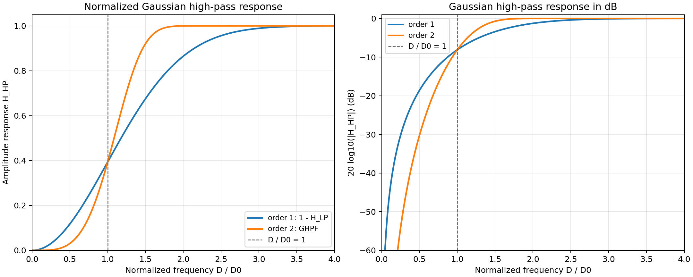

为了更清楚地说明频率响应差异对最终图像的影响，可将曲线特征与图像表现概括如下：

| 频率区域      | 图中响应特征                 | 一阶等效高通   | 二阶 GHPF              | 图像中的表现                                         |
| ------------- | ---------------------------- | -------------- | ---------------------- | ---------------------------------------------------- |
| `D/D0 < 1`  | 响应接近 0，dB 值较低        | 低频抑制较温和 | 低频响应更低，抑制更强 | 二阶结果中的背景渐变、阴影和大面积平滑结构更弱       |
| `D/D0 ≈ 1` | 曲线快速上升，是主要过渡区域 | 过渡较平缓     | 过渡更陡、过渡带更窄   | 二阶结果的边缘对比度更高，细节变化更明显             |
| `D/D0 > 1`  | 响应趋近 1，dB 值接近 0      | 高频逐渐通过   | 高频更快接近完全通过   | 二阶结果中的细线、纹理和边缘更突出，但噪声也可能增强 |

因此，普通高斯低通相减得到的一阶等效高通表现较温和，而二阶 GHPF 具有更强的低频抑制和更明显的高频细节增强效果。

### 3.2 Part B：参数调整结果

初始参数组为 `D0 = 5, 15, 30, 80, 230`。结果显示：`D0=5` 和 `D0=15` 的相减结果保留较多中频和整体结构，图像相对偏亮；`D0=230` 时低通图过于接近原图，高通结果变弱；`D0=80` 在初始参数组中与教材 Fig. 4.26(c) 最接近。

为了更准确地寻找匹配参数，本实验没有直接使用教材截图作为误差计算目标，而是根据教材图注中的 `order 2, D0=80` 自行生成二阶 GHPF 参考图。这样可以避免截图模糊、缩放和印刷噪声对比较结果的影响。随后计算不同相减结果与该参考图之间的像素误差。第二轮在 `D0 = 60, 65, 70, 75, 80, 85, 90` 中搜索，结果显示 `D0=70` 的 RMSE 最小。随后第三轮在 `D0=65-75` 范围内以步长 1 细调。比较结果显示，`D0=70` 的 RMSE 最小，为 2.9278；`D0=72` 和 `D0=71` 也非常接近，但 RMSE 略高。因此最终选择 `D0=70` 作为与二阶 GHPF `D0=80` 目标图最接近的相减法参数。

本实验使用 RMSE、平均绝对差和最大差作为辅助评价指标。原因是当 `D0` 调整到 `65-75` 区间后，各组高通结果在视觉上已经非常接近，单凭肉眼很难稳定分辨哪一张更接近参考图，因此需要引入数值误差作为判断依据。RMSE 会对局部较大的像素差异赋予更高权重，适合衡量整体图像是否存在明显偏离；平均绝对差反映全图平均灰度差异，能够描述一般意义上的整体接近程度；最大差用于观察是否存在局部极端误差。三者结合可以避免只根据主观视觉或单一指标下结论，使最终参数选择更有依据。

### 3.3 参数对比表

本表以 `results/project_04_04/temp_ghpf_d0_80_order_2.png` 作为参考目标，即二阶 GHPF、`D0=80` 的直接高通滤波结果。误差由 PNG 显示图逐像素计算，数值越小表示与目标图越接近。

#### 3.3.1 初始参数组

|  D0 |    RMSE | 平均绝对差 | 最大差 | 观察结论                                              |
| --: | ------: | ---------: | -----: | ----------------------------------------------------- |
|   5 | 24.1053 |    14.7123 |    135 | 相减结果过强，亮结构过多，与目标差异最大。            |
|  15 | 17.5802 |     8.0747 |    136 | 对应 Project 04-03(b)，但与二阶 GHPF 目标图差异明显。 |
|  30 | 11.0709 |     4.2103 |     99 | 仍保留较多中频结构，整体偏亮。                        |
|  80 |  3.2526 |     1.0197 |     38 | 初始参数组中最接近目标图。                            |
| 230 | 10.9135 |     3.2855 |    118 | 低通图太接近原图，高通结果偏弱。                      |

#### 3.3.2 第二轮搜索参数组

初始比较中 `D0=80` 最接近目标图，因此第二轮在其附近选取 `D0=60,65,70,75,80,85,90` 进行搜索。

| D0 |   RMSE | 平均绝对差 | 最大差 | 观察结论                         |
| -: | -----: | ---------: | -----: | -------------------------------- |
| 60 | 3.6265 |     1.2206 |     38 | 相比 80 偏强，误差较大。         |
| 65 | 3.1584 |     1.0159 |     38 | 接近目标，但仍高于 70。          |
| 70 | 2.9278 |     0.8921 |     38 | 第二轮中 RMSE 最小。             |
| 75 | 3.0022 |     0.9157 |     38 | 与 70 接近，但 RMSE 略高。       |
| 80 | 3.2526 |     1.0197 |     38 | 初始最佳参数，但细调后不是最优。 |
| 85 | 3.6293 |     1.1471 |     42 | 误差增大。                       |
| 90 | 4.0664 |     1.2887 |     47 | 误差继续增大。                   |

#### 3.3.3 第三轮细调参数组

第二轮中 `D0=70` 最接近目标图，因此进一步在 `D0=65-75` 区间以步长 1 进行细调。

| D0 |   RMSE | 平均绝对差 | 最大差 | 观察结论                            |
| -: | -----: | ---------: | -----: | ----------------------------------- |
| 65 | 3.1584 |     1.0159 |     38 | 接近目标，但误差仍高于最优值。      |
| 66 | 3.0891 |     0.9810 |     38 | 比 65 更接近。                      |
| 67 | 3.0261 |     0.9556 |     38 | 继续接近目标。                      |
| 68 | 3.0036 |     0.9409 |     38 | 与目标较接近。                      |
| 69 | 2.9548 |     0.9073 |     38 | 已接近最优区间。                    |
| 70 | 2.9278 |     0.8921 |     38 | RMSE 最小，最终选取。               |
| 71 | 2.9355 |     0.8896 |     38 | 与 70 非常接近，但 RMSE 略高。      |
| 72 | 2.9301 |     0.8867 |     38 | 与 70 非常接近，但 RMSE 略高。      |
| 73 | 2.9488 |     0.8799 |     38 | 平均绝对差最低，但 RMSE 略高于 70。 |
| 74 | 2.9616 |     0.8954 |     38 | 误差开始增大。                      |
| 75 | 3.0022 |     0.9157 |     38 | 误差继续增大。                      |

该结果说明：由普通高斯低通相减得到的一阶等效高通结果，可以通过调整 `D0` 接近二阶 GHPF 的视觉效果，但由于滤波器阶数不同，两者不会完全一致。

从实际输出图也可以观察到这一趋势。初始参数对比图中，`D0=5` 和 `D0=15` 的高通成分较强，字符轮廓和背景变化都较明显；`D0=230` 的结果则明显偏弱；`D0=80` 已经较接近教材参考图的暗背景和细节分布。第二轮和第三轮对比图进一步显示，`D0=70` 附近的结果与二阶 GHPF `D0=80` 参考图最接近，图像中的大字符边缘、竖线区域和右侧纹理区域都较好保留，同时整体背景没有过亮。差异放大图中仍可看到局部差异，说明相减法只能近似二阶 GHPF 的视觉效果，不能完全替代。

### 3.4 结果图

图 04-04-1 使用 Project 04-03(b) 的低通图像相减得到的高通结果，参数为 `D0=15`。该图对应题目 (a)，可见字符边缘和纹理被提取出来，但整体效果与教材二阶 GHPF 图像并不完全相同。


图 04-04-2 将 Part A 的相减高通结果与教材指定参数下的二阶 GHPF `D0=15` 结果放在一起比较。左侧为式 (4.4-14) 的 `original - lowpass(D0=15)`，右侧为直接二阶 GHPF `D0=15`。可以看到两者都突出高频细节，但亮度分布和局部细节强度不同，支持前文关于滤波器阶数差异的解释。

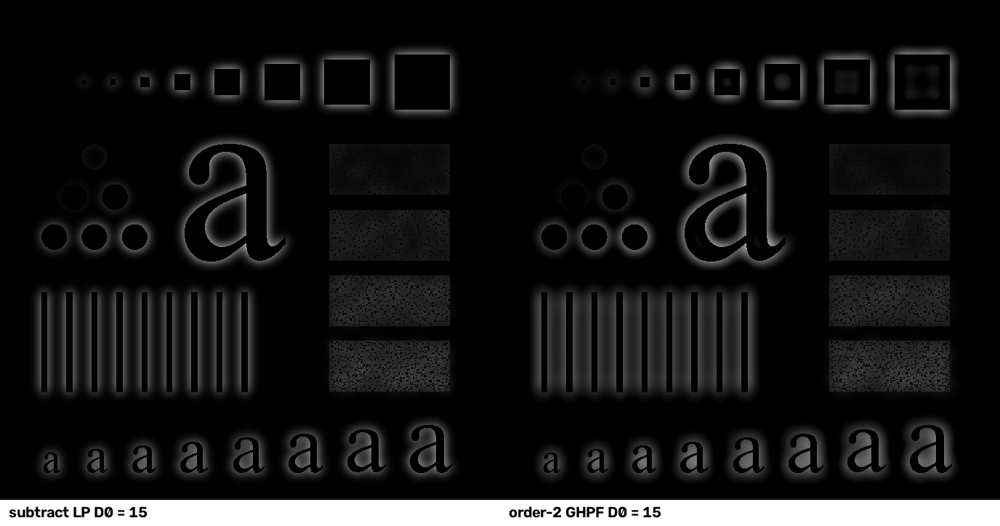

图 04-04-3 为初始参数 `D0=5,15,30,80,230` 的高通结果对比。可以看到 `D0` 较小时高通成分更强，图像较亮；`D0` 很大时结果变弱。初始比较中 `D0=80` 最接近教材目标图。

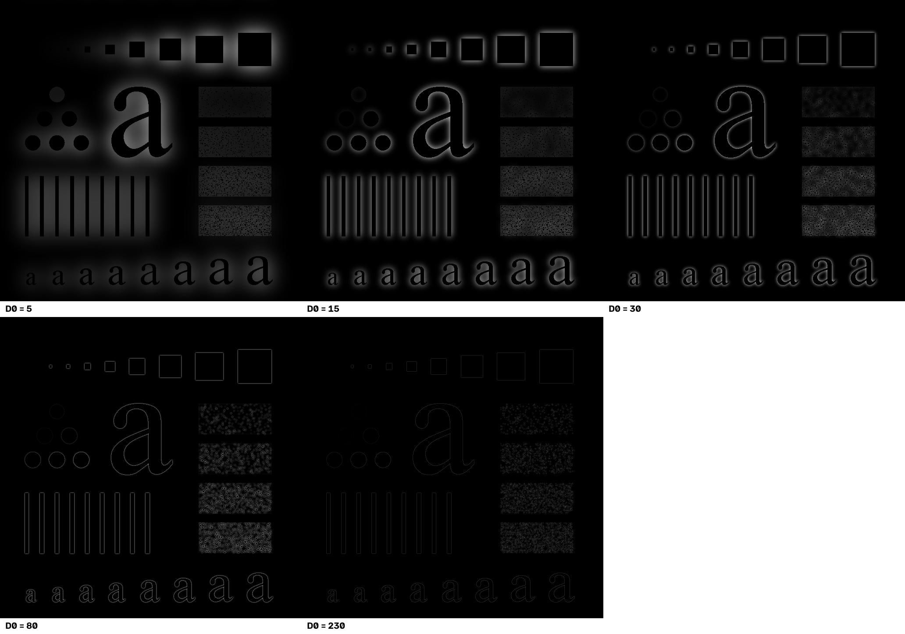

图 04-04-4 为第二轮搜索结果，对 `D0=60,65,70,75,80,85,90` 进行比较。该组结果显示最优区域位于 `D0=70` 附近。

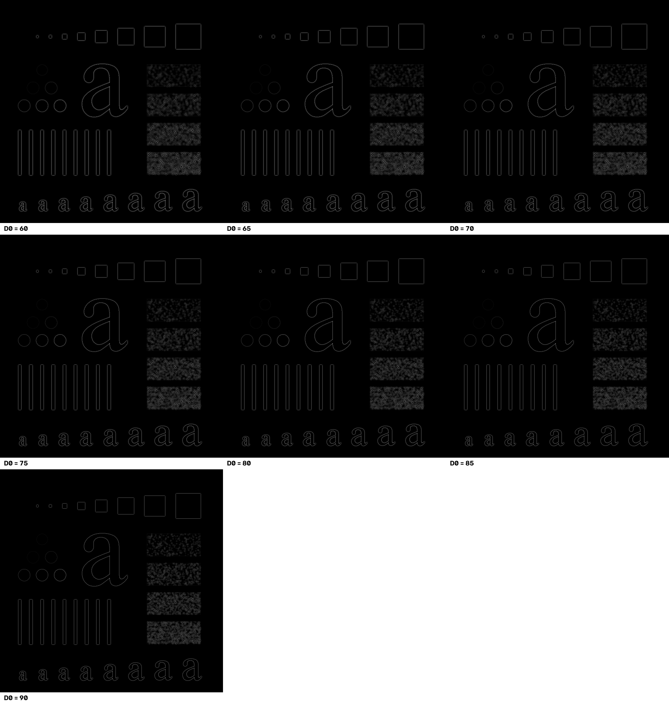

图 04-04-5 为第三轮细调结果，对 `D0=65-75` 逐一比较。该图中多张结果肉眼差异已经较小，因此结合 RMSE、平均绝对差和最大差进行定量判断，最终选取 `D0=70`。

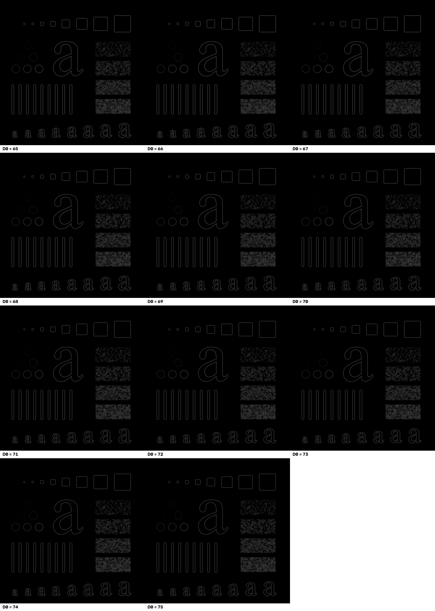

图 04-04-6 为根据教材 Fig. 4.26(c) 参数自行生成的二阶 GHPF `D0=80` 参考图。由于教材截图较模糊，本实验使用该图作为更清晰、可复现的比较目标。

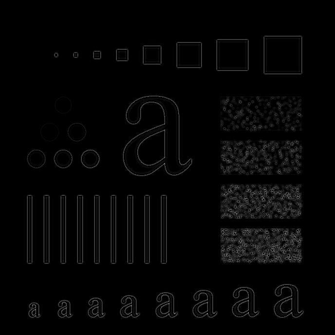

图 04-04-7 为最终最佳参数 `D0=70` 的相减结果与二阶 GHPF `D0=80` 参考图之间的差异放大图，差异被放大 4 倍显示。图中仍有局部灰度差异，说明两者相近但不完全相同。


## 4. 创新点及思考

本实验在完成原图减低通图构造高通图像的基础上，额外实现了广义高斯高通滤波器，用于生成教材 `order 2` 的参考结果。通过绘制一阶与二阶高斯高通的归一化频率响应及 dB 特性曲线，直观解释了两种滤波器在低频抑制、截止频率附近过渡以及高频细节保留方面的差异，并进一步说明这些频域差异如何影响输出图像的亮度分布、边缘强度和细节增强效果。

此外，本实验没有只依赖主观视觉判断，而是使用 RMSE、平均绝对差和最大差对不同 `D0` 参数进行定量比较，最终确定 `D0=70` 的相减结果与二阶 GHPF `D0=80` 参考图最接近。实验结果表明，`original - lowpass` 与一阶 GHPF 等价，但不能通过简单调整 `D0` 完全替代二阶 GHPF，只能在视觉和数值上进行近似。

## 5. 实验总结

本实验完成了由低通图像构造高通图像的过程，理解了式 (4.4-14) 的含义及其频域解释。实验中最容易混淆的是“相减法高通结果”和“教材二阶 GHPF 直接滤波结果”的关系。通过辅助实现 GHPF 并进行定量对比，可以明确两者差异主要来自滤波器阶数和显示方式。最终在细调参数后，选择 `D0=70` 作为与教材 Fig. 4.26(c) 最接近的相减法参数。

# Project 04-05：Correlation in the Frequency Domain（频率域相关）

## 摘要

本实验项目复现例 4.11 的频率域相关过程，用 Fig. 4.41(b) 中的字母"T"来定位 Fig. 4.41(a) 中的对应位置。具体实现是将 256×256 的图像和裁剪后 38×42 的模板分别补零至 298×298 后，计算图像频谱与模板频谱复共轭的乘积，再进行二维逆傅里叶变换，从而得到二维相关函数。本实验所求得的最大相关值约为 21352516，位于从零开始计数的 。这个坐标表示的是模板的左上角，绘制的匹配框覆盖原图中的"T"。并且经验证，空间域逐像素乘积求和也能够得到相同的峰值，由此证明了这个项目实现与坐标解释的正确性。

## 1. 实验题目

### 1.1 实验内容

**在频域中进行相关分析：**

要求使用 Fig. 4.41(a) 的图像和 Fig. 4.41(b) 的模板，复现 Example 4.11 的拓展、频率域相关与结果显示过程，以获得与 Fig. 4.41(e) 对应的二维相关图，标出二维相关函数中最大值所在位置的 (x，y) 坐标，无需在图 4.41(f) 中绘制该分布曲线。

### 1.2 实验目的

- 理解模板平移时相关值如何衡量局部相似程度；
- 掌握空间域相关如何通过频谱共轭相乘和逆变换实现；
- 掌握在频域中进行相关分析的代码和算法实现过程。

## 2. 技术讨论

### 2.1 算法原理

#### 2.1.1 模板匹配与图像相关基本原理

本实验以 Fig. 4.41(a) 为输入图像，以 Fig. 4.41(b) 中的"T"为模板，利用二维相关原理确定模板在图像中的位置。将模板在图像上逐位置移动，在每个位置对模板像素与对应图像像素逐点相乘并求和，可以得到该位置的相关值。设输入图像为 $f(x,y)$，模板为 $w(m,n)$，模板宽为 $C$、高为 $D$，当模板左上角位于 $(x,y)$ 时，有

$$
r(x,y)=\sum_{n=0}^{D-1}\sum_{m=0}^{C-1}f(x+m,y+n)w(m,n).
$$

在这个式子中，$(m,n)$ 是模板内的像素坐标，$(x+m,y+n)$ 是输入图像中对应的像素坐标。相关函数最大值所在的位置是本实验得到的最佳匹配位置。本实验使用原始灰度相关值，输出的 $(x,y)$ 表示**裁剪后的模板左上角**在图像中的位置，坐标原点位于图像左上角，$x$ 为列、$y$ 为行，均从零开始。

#### 2.1.2 频域相关理论

如果在空间域直接求完整相关函数，需要对各个模板位置分别执行逐像素乘积求和，比较繁琐且计算量巨大。依据傅里叶变换的相关定理，可以将这一计算转换为频率域中的逐点乘法，计算量大大减少，最后再通过逆变换，即可得到二维相关函数。

对零填充后的图像与模板分别求二维傅里叶变换，记其频谱分别为 $F(u,v)$ 和 $W(u,v)$，则

$$
r(x,y)=\mathcal{F}^{-1}\!\left\{F(u,v)W^{*}(u,v)\right\}.
$$

其中，$F(u,v)$ 为输入图像频谱，$W(u,v)$ 为模板频谱，$W^{*}(u,v)$ 为模板频谱的复共轭，这里是按照示例中对模板频谱取共轭。两者在频率域逐点相乘后，经二维逆傅里叶变换即可得到空间域相关函数。我实际实现的程序这里仅取逆变换结果的实部，以消除浮点运算产生的微小虚部。

#### 2.1.3 零填充技术

有限尺寸的 FFT 在未充分补零时会产生循环相关，边界处的响应可能会周期性绕回并且发生混叠。为了获得所需的线性相关结果，我这里按照示例将图像和模板分别放置在零数组的左上角。

输入图像的宽、高均为 256 像素，实验提供的原模板截图为 49×44 像素，因为示例中模板为 38×42 像素，这里为了与示例保持一致，我的程序使用半开裁剪框 `(6, 1, 44, 43)` 去除外围黑边，对原模版进行裁剪，得到宽 $C=38$、高 $D=42$ 像素的模板，这个裁剪过程是在程序运行过程中去做的，没有直接改动一开始输入的模板图像。

由零填充理论，输入图像宽为 $A=256$、高为 $B=256$，则线性相关所需的最小补零尺寸为

$$
P=A+C-1=256+38-1=293 \\
Q=B+D-1=256+42-1=297.
$$

因此，本实验采用宽、高均为 298 像素的零填充数组，这样能够同时满足 $P$ 和 $Q$ 的要求。代码中的 `padded_shape=(298, 298)` 即是按 NumPy 的 `(高度, 宽度)` 顺序表示这个尺寸。

#### 2.1.4 基于 FFT 的频域相关算法流程

程序按照以下顺序执行：

1. 读取输入图像 `input/4.41a.jpg` 和模板截图 `input/4.41b.png`，将它们转换为灰度图；
2. 按 `(6, 1, 44, 43)` 裁剪模板，得到 38×42 像素的计算模板；
3. 将输入图像和裁剪后的模板分别置于 298×298 零数组的左上角；
4. 分别进行二维 FFT，获得图像频谱 $F(u,v)$ 和模板频谱 $W(u,v)$；
5. 将 $F(u,v)$ 与 $W^{*}(u,v)$ 逐点相乘；
6. 对乘积进行二维 IFFT，取实部得到二维相关函数；
7. 在原始相关数组中搜索最大值，并将数组的 `(行, 列)` 索引转换为题目所需的 $(x,y)=(列,行)$ 坐标。本次实验得到 $(108,107)$。

### 2.2 实现技术

#### 2.2.1 实验技术实现

- `np.fft.fft2()` 用来实现二维 FFT；
- `np.conj()` 对模板频谱取复共轭；
- `np.fft.ifft2()` 将频域乘积变换为二维相关函数；
- `np.argmax()` 寻找原始相关数组的最大值，随后由 `np.unravel_index()` 还原二维索引；
- `frequency_correlation` 函数负责补零及频域运算，最后 `main` 函数完成输入预处理和最大值位置提取；
- 将原始数组存为 `.npy`，峰值与空间域校验结果存为 `.json`，另将相关值映射为 PNG 用于观察。在线性显示图中最大非负值映射为 255，对数显示图则突出弱响应，两者都不改变原始相关值。

#### 2.2.2 关键代码展示

以下仅列出 `src/project_04_05.py` 中与算法原理、实验方法对应的核心代码，完整可运行程序见该源文件。

**裁剪模板**

```python
CROP_BOX = (6, 1, 44, 43)

# 裁剪框是 (左, 上, 右, 下)，右、下边界不包含在内。
template = template_original.crop(CROP_BOX)
```

`crop` 在内存中生成裁剪结果，不会覆盖原始输入文件，这个裁剪操作是为了让使用的模板与示例保持一致。

**补零与频域相关：`frequency_correlation`**

```python
def frequency_correlation(image, template, padded_shape):
    image_array = np.asarray(image)
    template_array = np.asarray(template)
    image_height, image_width = image_array.shape
    template_height, template_width = template_array.shape

    # 图像和模板都放在零数组的左上角
    image_padded = np.zeros(padded_shape)
    template_padded = np.zeros(padded_shape)
    image_padded[:image_height, :image_width] = image_array
    template_padded[:template_height, :template_width] = template_array

    # 模板频谱取共轭相乘，再逆变换得到相关函数
    image_spectrum = np.fft.fft2(image_padded)
    template_spectrum = np.fft.fft2(template_padded)

    # 频域相关函数
    correlation = np.fft.ifft2(image_spectrum * np.conj(template_spectrum)).real
    return correlation, image_padded, template_padded
```

`np.asarray` 将灰度图转换为数组，`shape` 给出高度和宽度，`np.zeros` 默认建立浮点零数组，大小为 `padded_shape=(298, 298)`，切片赋值将图像和模板置于各自数组的左上角，同时把像素值转为浮点数。函数末尾依次执行两次 `fft2`、模板频谱取共轭并逐点相乘，以及 `ifft2` 逆变换。`.real` 去除数值误差引入的微小虚部，函数同时返回原始浮点相关数组和实际用于 FFT 的两个补零数组。

**寻找峰值及坐标**

```python
padded_shape = (298, 298)
correlation, image_padded, template_padded = frequency_correlation(
    image, template, padded_shape
)
peak_y, peak_x = np.unravel_index(np.argmax(correlation), correlation.shape)
peak_x = int(peak_x)
peak_y = int(peak_y)
peak_value = float(correlation[peak_y, peak_x])
```

`np.argmax` 在 298×298 的**原始相关数组**中找到最大值的一维序号，`np.unravel_index` 将其还原为 `(行,列)`。因此变量先写 `peak_y`、后写 `peak_x`，之后再按 `(x,y)` 输出。

**空间域逐像素求和校验：`verify_spatial_correlation`**

```python
# 验证频域相关函数与空间相关函数的一致性
def verify_spatial_correlation(image, template, correlation):
    image_array = np.asarray(image, dtype=float)
    template_array = np.asarray(template, dtype=float)
    template_height, template_width = template_array.shape
    valid_height = image_array.shape[0] - template_height + 1
    valid_width = image_array.shape[1] - template_width + 1
    spatial = np.empty((valid_height, valid_width))

    # 逐位置计算像素乘积和，与频域结果比较。
    for row in range(valid_height):
        for column in range(valid_width):
            region = image_array[row:row + template_height, column:column + template_width]
            spatial[row, column] = np.sum(region * template_array)

    spatial_peak_y, spatial_peak_x = np.unravel_index(np.argmax(spatial), spatial.shape)
    max_error = float(np.max(np.abs(spatial - correlation[:valid_height, :valid_width])))
    return int(spatial_peak_x), int(spatial_peak_y), float(spatial[spatial_peak_y, spatial_peak_x]), max_error
```

这个验证函数只对模板完全位于原图内的有效位置逐点计算空间域相关，然后与 FFT 结果的相应区域比较，它是频域计算后的独立校验，不是本项目题目要求的频域相关算法。主程序负责输出空间域峰值位置，并将其峰值和最大绝对误差写入 `04_05_peak.json`。

**相关结果可视化：`display_correlation`**

```python
def display_correlation(correlation, logarithmic=False):
    # 显示用的灰度图，找最大值时仍使用原始相关数组。
    nonnegative = np.maximum(correlation, 0)
    peak_value = nonnegative.max()
    if logarithmic:
        scaled = np.log1p(nonnegative) / np.log1p(peak_value)
    else:
        scaled = nonnegative / peak_value
    return Image.fromarray(np.round(255 * scaled).astype(np.uint8))
```

图像文件需要可显示的灰度范围，这里先把负响应截为 0，再把最大非负值缩放为 255。`logarithmic=True` 时使用对数映射，便于看到较弱响应，这个仅作为**显示处理**，不用于求峰值。

**结果显示与保存**

最后用 `.npy` 文件保存完整浮点相关数组，PNG 文件用于结果展示。

程序输出会将结果在交互窗口中弹窗展示，终端会输出相关函数最大值位置坐标和最大值，并将完整结果均保存到`results/project_04_05/`目录下。

#### 2.2.4 实验环境

- 操作系统：Windows。
- 编程语言及版本：Python 3.12.7。
- 使用的库及版本：NumPy 1.26.4、Pillow 10.4.0、Matplotlib 3.10.0。
- 输入图像及来源：项目提供的 Fig. 4.41(a) 图像和 Fig. 4.41(b) 模板截图。
- 输出文件名称与格式：`results/project_04_05/04_05_*.png` 为展示图，`results/project_04_05/04_05_correlation.npy` 为完整浮点相关数组，`results/project_04_05/04_05_peak.json` 记录峰值与空间域校验结果。

## 3. 结果讨论

### 3.1 结果展示

图 04-05-1、04-05-2 展示原图和裁剪模板，图 04-05-3、04-05-4 展示分别补零至 298×298 后实际参与 FFT 的图像与模板，对应例 4.11 的延拓步骤。

图 04-05-5 至 04-05-7 展示程序算法运行后求得的相关函数及峰值位置。图注中的尺寸为文件的实际像素尺寸，交互窗口中的模板图像经过显示缩放，算法输入时仍保持原像素。精确相关值可以查看 `results/project_04_05/04_05_peak.json` 和 `results/project_04_05/04_05_correlation.npy` 文件。

- 图 04-05-1：输入图像 Fig. 4.41(a)，256×256 像素。
  
- 图 04-05-2：由 Fig. 4.41(b) 截图裁剪的 38×42 模板。
  
- 图 04-05-3：输入图像左上角对齐并补零后的 298×298 灰度图，其余区域为零。
  
- 图 04-05-4：裁剪模板左上角对齐并补零后的 298×298 灰度图，其余区域为零。
  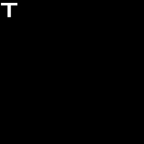
- 图 04-05-5：298×298 二维相关函数，非负值相对峰值线性映射到 0–255。
  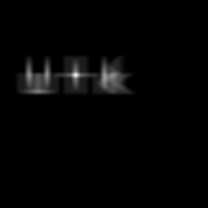
- 图 04-05-6：对原图上的峰值位置，用模板大小的标注框进行标注，标注框从最大值位置框选模板在原图的匹配位置。
  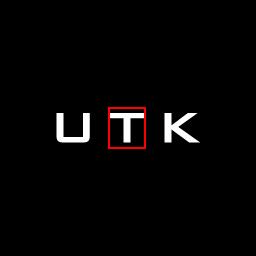
- 图 04-05-7：对数映射的相关函数辅助观察图。
  

### 3.2 结果分析

**峰值与定位：** 二维相关数组尺寸为 298×298。全局最大值约 21352516，坐标为 $(108,107)$。将模板的左上角放在此处，即图 04-05-6 所示的标注框，可以看到 38×42 的标注框的确覆盖了原图中的"T"。因此本次定位与例题对最高峰位于"T"顶部附近的描述一致。这里峰值坐标是相关函数数组的索引，由实现过程中图像的放置规则可知，也代表该模板左上角的放置位置。

**数值校验：** 程序中的 `verify_spatial_correlation` 对原图中所有允许模板完全放置的位置直接执行了逐像素乘积求和，由此得到空间域相关函数的最大值为 21352516，坐标为 $(108,107)$，而 FFT 数组在该点的值约为 21352516。经程序计算比较可得两个有效区域逐点比较的最大绝对误差约为 $4.10\times10^{-8}$，属于浮点运算误差。

这个数值校验既检查了本实验中峰值的计算是否正确，也检查了有效区域的索引方向与频域公式的正确性，是对现有实现的一致性验证。校验数值记录在 `results/project_04_05/04_05_peak.json` 中。

**显示与参考图：** 在线性显示图中，可以看到"T"所在区域形成最明显的响应，而对数显示图放大较弱了响应，因此也能看到其他字母附近较明显的相关结构。两张显示图都把负值截为0，并对非负值作了可视化映射，因此图上的灰度不等于原始相关值。

与 Fig. 4.41(e) 对比，可以核对峰值所在的位置及图像总体形态，经核对对比及上述多重校验可以判断，此实验所得结果是正确的。

## 4. 创新点及思考

**独立验证与可复现记录：** 在题目要求的相关图和峰值坐标之外，我还保留了原始相关数组与 JSON 峰值记录，便于核对和查验结果，并且也通过空间域逐像素求和交叉验证了频域结果的正确性。这两种计算方法在有效区域内达到误差范围内的一致性，这样做便于发现共轭遗漏、行列颠倒或填充不足等实现问题。

**验证依据的适用范围：** 匹配位置标记覆盖目标区域，说明模板定位结果在视觉上与预期一致，但这个结果只能验证匹配位置的合理性，不能单独证明相关函数计算过程是否正确。由于相关函数可能存在其他局部峰值，还需要进一步确认最大值来源于原始相关数组，而不是归一化或增强后的显示图像。

在满足零填充条件下，根据傅里叶相关定理，空间域直接计算得到的相关函数应与通过 FFT 频域乘法并逆傅里叶变换得到的相关函数保持一致。因此，本实验中视觉核对主要用于验证定位结果，而数值校验用于验证相关计算过程，这里两者同时验证本实验结果的正确性。

**思考**

**此方法的局限与可继续探索的问题：** 当前采用未归一化灰度相关，相关值直接由像素乘积累加得到，因此对图像整体亮度的变化较为敏感，当其他区域具有较高平均灰度时，就可能产生较大的相关响应。

此外，本实验的这个方法很依赖模板与目标区域之间的像素对应关系，当目标发生旋转、缩放或笔画变化时，匹配峰值就可能降低。因此考虑后续可以进一步引入零均值归一化相关方法，比较不同亮度条件下的匹配，同时还可以研究不同模板裁剪范围对匹配位置和相关峰值的影响。

## 5. 实验总结

本实验利用傅里叶变换的相关定理实现了图像与模板的二维相关，并通过相关函数的最大值确定了模板在输入图像中的位置。所得结果与原图中"T"的位置一致，空间域的计算也辅助验证了频域结果的数值正确性。通过本实验，我们进一步理解了零填充、频谱复共轭相乘和逆变换在频域相关中的作用，也认识到了相关峰值与模板匹配位置之间的关系。

## 附录：文件清单

### Project 04-03

- 核心程序：`src/common_io.py`、`src/project_04_03.py`。
- 测试程序：`src/tests/test_project_04_03.py`。
- 输入文件：`input/Fig0441(a)(characters_test_pattern).tif`。
- 结果文件：`results/project_04_03/04_03_*.png`、`results/project_04_03/04_03_*.npy`、`results/project_04_03/04_03_metrics.csv`、`results/project_04_03/04_03_metadata.json`。

### Project 04-04

- 核心程序：`src/project_04_04.py`。
- 实验记录：`docs/04_04_notes.md`、`docs/04_04_compare_table.md`。
- 输入文件：使用 Project 04-03 的字符测试图及低通处理结果。
- 结果文件：`results/project_04_04/04_04_*.png`、`results/project_04_04/04_04_*.npy`、`results/project_04_04/temp_ghpf_*.png`、`results/project_04_04/temp_ghpf_*.npy`。

### Project 04-05

- 核心程序：`src/project_04_05.py`。
- 输入文件：`input/4.41a.jpg`、`input/4.41b.png`。
- 结果文件：`results/project_04_05/04_05_*.png`、`results/project_04_05/04_05_correlation.npy`、`results/project_04_05/04_05_peak.json`。

### 公共文件

- 依赖说明：`requirements.txt`。
